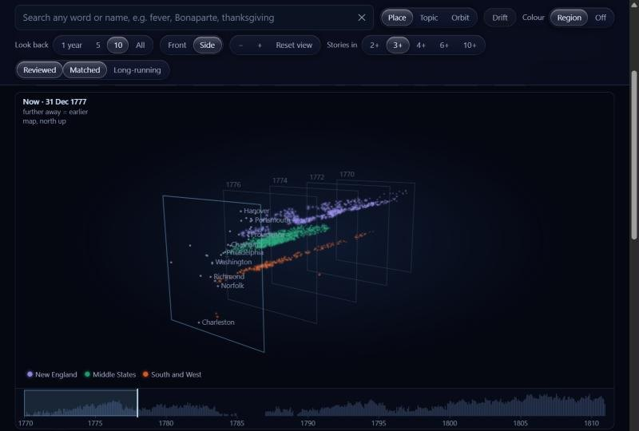
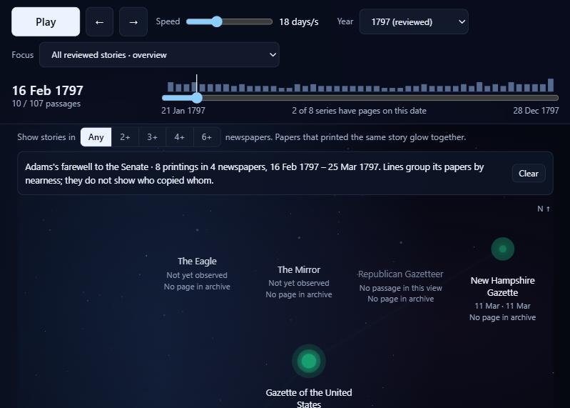
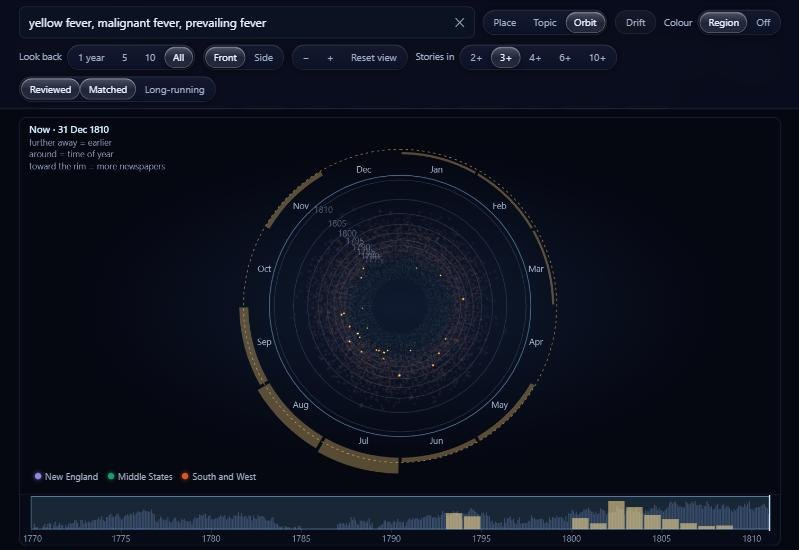
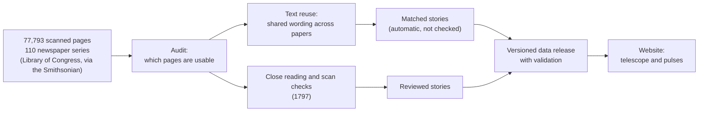

# Newspaper Night Sky

**How news moved through American newspapers, 1770–1810.**
Every story printed in two or more papers of one surviving archive, 48,148 in all. You can explore them as a sky of stars, or follow one story from paper to paper as it pulses through them.

**[Open the website →](https://newspapers.icare.love/)** · [How it works](https://newspapers.icare.love/method.html) · Major Studio 1, Project 02



## The question

Society has a limited amount of attention, and problems keep coming back. So what can a surviving archive of early American newspapers show about how news spread, how long it stayed in print, and what kept coming back?

The project answers with **observed facts, not big claims**: *newspaper X printed this on date Y*. It never draws who-copied-whom lines unless a paper names its source. It also shows where the archive is missing pages, so a gap in the archive is never mistaken for silence. Readers draw their own conclusions.

## What you can do on the site

| Page | What it shows |
|---|---|
| **[Telescope](https://newspapers.icare.love/telescope.html)** | All 48,148 stories as stars. Time runs into the depth: the front is "now", and the further away a star is, the earlier the story. You can arrange the stars by **place** (town of first printing), **topic** (24 topics in seven families), or **orbit** (time of year), and colour them by **region**. You can also search any word, turn and zoom the view, and let time drift. |
| **[Pulses](https://newspapers.icare.love/pulses.html)** | One story at a time. Each newspaper is a point on a map, and it pulses when it printed the story. The passage and the page scan are shown beside the map. A constellation joins a story's printings, and a coverage strip shows which pages survive. |
| **[How it works](https://newspapers.icare.love/method.html)** | The method in plain language, and what the site cannot tell you. |

| | |
|---|---|
|  |  |

## What it shows

- **Reprinting was how news travelled.** The archive holds 48,127 stories printed in two or more of its papers (179,966 printings in all). About two thirds of them were printed in exactly two. In 1776 the Declaration of Independence appears in 13 of the archive's papers.
- **Some news returns with the seasons.** Independence Day stories cluster in summer: 81% fall in July–September, in 25 of the 30 years that have them. The President's annual speech comes in November–January, fever in late summer, ice in winter, and Congress while it sits. Fires show no rhythm. The surviving pages are spread evenly over the year, so these rhythms do not come from gaps in the archive. ([the check](docs/seasons-check.md))
- **The archive has a shape.** Only two newspaper series survive for 1785–86, against 11 to 17 a year after 1800. Before 1800 the papers are mostly from New England and the Middle States; from 1802 about half are from Virginia, Washington, Kentucky and South Carolina. The site keeps these gaps visible.
- **Machine transcriptions need checking.** For 1797, 21 stories were read closely and every printing was checked against its scan. In one, the transcription reads "distressed" where the paper printed "dismasted". Another transcription leaves out a 350-word statement that is plainly on the page.

## How it was made



There are two tiers of story, and they are kept apart everywhere:

- **Reviewed stories** were read, grouped, and checked against the scans.
- **Matched stories** were found automatically by long runs of shared wording, and nobody has checked them.

The reading and scan checks were done with AI assistants. An independent human second reading is still to come. The full account is in [docs/process.md](docs/process.md).

## Repository

| Folder | What is in it |
|---|---|
| [`site/`](site) | The website, ready to serve: five pages and the data they load. The first telescope is kept as `telescope-v1.html`. |
| [`data/`](data) | The current data release (v0.5.2): tables, the matched-story data, the schema and the validation |
| [`pipeline/`](pipeline) | The code, in the order it runs: audit, topics, finding stories, data releases, the site |
| [`docs/`](docs) | The full process, the seasons check, and the site plan |
| [`process/`](process) | How the three original proposals and their sketches became this site |

**Run the site locally** (any Python 3):

```bash
python -m http.server 8000 --directory site
```

Then open <http://localhost:8000>. The pages load their data over HTTP, so opening the files directly does not work.

## Limits

- **Not everything printed:** the site shows only what survives in this collection and could be read from its transcriptions.
- **Not public opinion:** how often papers printed something is not how much people cared about it.
- **Not copying routes:** the order of printing does not show who copied whom, unless a paper names its source.
- **Matched stories are not checked:** a match can join neighbouring items, and damaged text is missed.

## Credits

**Data:** the Smithsonian's *Revolution Crossroads* collection, drawn from the Library of Congress's *Chronicling America* newspapers. It is the Hugging Face dataset `RevolutionCrossroads/loc_chronicling_america_1770-1810`, pinned at revision `0b97906`.

**Made by** Haolong for Major Studio 1. The analysis, code and writing were developed with AI assistants (OpenAI Codex and Anthropic Claude Code). The sketches in `process/` are AI-assisted digital drafts.
