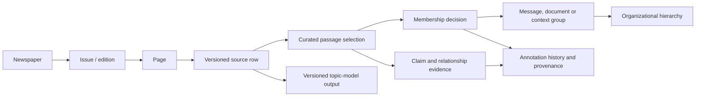

# Newspaper research data foundation

This is a reusable, versioned data release underneath the visualizations. It joins the archive inventory, existing inspected passages, grouping decisions, evidence records, and frozen topic-model outputs. It does not add a new historical event census.

## Changes in v0.10.2 (2026-11-10)

v0.10.2 is v0.10.1 with **the Kentucky Gazette issues filed two years late dated by their mastheads**, and their pages matched again in the windows of their printed dates. It was made by `redate_issues.py --keep-current` from `outputs/kentucky_gazette_dates/`, at the owner's word. `CURRENT.json` is not moved. Nothing reviewed changes.

- **Issue dates:** the collection files 106 issues of the *Kentucky Gazette and General Advertiser* (sn84038147) two years late. The 7 of November–December 1804 are filed under 1806, the one of 28 May 1805 under 1807, and the 98 of 1806 under 1808 (one, of 5 July 1806, under 3 July 1808). `issues.publication_date` is now the printed date. The dates come from 91 mastheads, 13 by the two-year rule where the masthead cannot be read or reads wrong (the weekday is one of the paper's publication days), and 2 read on the scans.
  - **Ids keep the filed date**, because they are the keys of the source rows and scan files. Each change is in `table_corrections` with its old value and evidence, and the new metadata key `issue_date_corrections` sums them up.
  - The topic census's date, year and month follow (439 pages).
- **Effect on years (newspapers, surviving pages):**

  | Year | Before | After | Change |
  |---|---|---|---|
  | 1804 | 14, 3,444 | 14, 3,472 | +7 issues |
  | 1805 | 13, 3,806 | 14, 3,811 | +1 issue |
  | 1806 | 12, 4,003 | 12, 4,381 | +98 issues, −7 |
  | 1807 | 12, 4,167 | 11, 4,162 | −1 issue |
  | 1808 | 11, 4,466 | 10, 4,060 | −98 issues |
- **Matched stories:** `outputs/kentucky_gazette_dates/rematch.py` applies the matcher's rules to these pages in the windows of their printed dates. It reproduces their 95 stored matches exactly with the filed dates first. Matches between other papers are kept.
  - **Matches:** the 95 are replaced by 4,506 new ones (3,935 main).
  - **Printings:** 27 leave: the 17 on these pages, 9 in 8 two-paper stories that are dropped (their pairs are about two years apart), and 1 that no longer matches its story. 884 are added: 494 join 386 stories, and 390 form 151 new stories, whose ids continue their year's numbering. In all, 163,841 → 164,698 printings.
  - **Stories:** 48,127 → 48,270.
  - **Rules:** a passage that would link two stories joins the one it shares the most words with, and stories are not merged (57 cases). Existing printings keep their spans and excerpts. Labels and titles are remade only where the first printing changed (52 stories).
  - **Derived rows:** the new printings have transcription checks (768 of the 884 confirmed). The 544 stories that changed or are new have topic rows, scored together (`run:story-topics-kentucky-gazette`).
- **Runs:** `run:kentucky-gazette-dates-v1` (the dates), `run:kentucky-gazette-rematch-v1` (the corrections, matches, stories, printings, titles and checks) and `run:story-topics-kentucky-gazette`, all automatic.
- **Checks:** `validate.py` adds six checks for releases that carry `issue_date_corrections`:
  - every corrected issue keeps its filed date in its id;
  - printings, stories, match ends and the topic census carry their issues' dates;
  - no match pairs pages more than 120 days apart;
  - the three runs are automatic.

## Changes in v0.10.1 (2026-11-10)

v0.10.1 is v0.10.0 plus **round two of the reviewed stories of 1793**, from `ledgers/stories_1793_round2.json` applied with `apply_ledger.py --keep-current`, **with their topic rows**. Nothing else changes. `CURRENT.json` is not moved.

- **The rule for 1793:** the owner agreed (2026-11-10) to a 6-paper threshold for this year, which round one had proposed because 1793 has only 6 to 8 papers in print at a time. Items are counted item by item as before; items that need framing stay out.
- **6 new single stories, 37 printings in 9 newspapers** (`obs:expansion-1793:S93-075` to `S93-111`, run `run:stories-1793-round2`): the list of the powers at war with France (6 papers, two introductions counted as one list), the London Gazette's Tournai bulletin of 3 May (6), Hamilton's circular to the collectors with the President's rules on neutrality (6), the President of the National Convention's declaration of a plot (6), the Cadiz letter of 24 June (6) and the commissioners' letter on General Dampierre's death (6).
- **1793 in all:** 12 stories, 19 groups, 111 printings in 9 newspapers (11 catalogue series).
- **Scan check of every new printing:** all 37 on their pages; 6 boxes placed by hand. Transcriptions, judged on the excerpt: 26 faithful, 6 with minor errors and 5 with errors that change a fact.
- **Topic rows:** the 6 new groups are scored under `run:story-topics-stories-1793-round2`; the reviewed rows already there are reproduced exactly.

## Changes in v0.10.0 (2026-11-10)

v0.10.0 is v0.9.0 plus **the reviewed stories of 1793**, the fifth reviewed year, from `ledgers/stories_1793.json` applied with `apply_ledger.py --keep-current`, **with their topic rows**. Nothing else changes. `CURRENT.json` is not moved; the site needs categories for the new stories first (and for those of 1808, which v0.10.0 also holds).

- **6 stories, 13 groups, 74 printings in 9 newspapers (11 catalogue series)** (`obs:expansion-1793:S93-001` to `S93-074`, namespace `expansion-1793`, run `run:stories-1793`).
  - Four are single stories: the Brussels paragraph of 17 October 1792 on the emigrant princes' armies, Dumouriez's letter on entering Brussels, Captain Crabtree's sea serpent and the Madeira report of a battle near Lisle. Two are parent stories: Dumouriez's defection (4 groups) and Genêt and the President (3 groups).
  - Only 10 single items of 1793 reach 7 papers, and none reaches 8, because the year has few papers in print (6 to 8 at a time, 4 to 6 from October). Three sub-stories have fewer than 7 papers under parents that reach 7, the rule agreed for 1776 round two. A 6-paper threshold for this year is proposed in `outputs/story_discovery_1793/README.md` and was not applied.
  - The selection rule, the items not admitted and the items left out because they need framing are in the ledger's `dispositions_summary` and in that README.
- **How they were found:** `work/story_items.py --long-running`, with families of 3 or more papers (`items.json`), and once with year 1792 over the 1793 pages (`items_from_1792.json`; nothing reaches 6 papers).
- **Scan check of every printing:** all 74 are on their pages; 7 boxes were placed by hand, and they are in the ledger (`scan_boxes`). Transcriptions, judged on the excerpt: 38 faithful, 34 with minor errors and 2 with errors that change a fact (RevX drops a sentence or a paragraph's substance).
- **Data faults found here, not corrected:** two *Gazette of the United States* issues are filed under dates their mastheads contradict (filed 4 April = 4 May; filed 23 July = 13 July; `outputs/story_discovery_1793/masthead_dates.csv`), and pages 3 and 4 filed under the *American Herald of Liberty* of 2 July are a second scan of the 9 July pages (`page_date_flags.csv`). No reviewed printing uses them. The *Kentucky Gazette* of 1793 is filed under its own dates.
- **Topic rows:** the 13 new groups are scored under `run:story-topics-stories-1793`; the 162 reviewed rows already there are reproduced exactly.
- **Checks:** 1,218 pass (1,140 before, plus one for each of the 78 new crops).

## Changes in v0.9.0 (2026-11-10)

v0.9.0 is v0.8.1 plus **the reviewed stories of 1808**, the fourth reviewed year, from `ledgers/stories_1808.json` applied with `apply_ledger.py --keep-current`, **with their topic rows**. Nothing else changes. `CURRENT.json` is not moved; the site needs categories for the new stories first.

- **20 stories, 50 groups, 298 printings in 10 newspapers** (`obs:expansion-1808:S08-001` to `S08-298`, namespace `expansion-1808`, run `run:stories-1808`).
  - Eleven are single stories. Nine are parent stories with 30 sub-stories: the embargo laws (5 groups), the charges against General Wilkinson (4), orders and decrees against neutral trade (3), Algiers and the American ships (3), the British and French papers laid before Congress (4), the embargo at home in spring (3), two letters from Alicante (2), the conventions in Portugal (2), and the President's message of 8 November with its documents (4).
  - The selection rule, the items not admitted and the items left out because they need framing are in the ledger's `dispositions_summary` and in `outputs/story_discovery_1808/README.md`. Seven sub-stories have fewer than 7 papers under parents that reach 7, the rule agreed for 1776 round two.
- **How they were found:** as for 1807 (`work/story_items.py --long-running`), run twice over the 1808 pages: with year 1808 (`items.json`) and with year 1807 (`items_from_1807.json`), because the script takes families by their first year, and several of 1808's most printed documents sit in families that began in 1807.
- **Scan check of every printing:** all 298 are on their pages (2 only partly shown). 43 crops were cut again from the text layer by other rules, 23 had overlapping boxes merged, and 18 boxes were placed by hand; the boxes of all 84 are in the ledger (`scan_boxes`). Transcriptions, judged on the excerpt: 201 faithful, 71 with minor errors and 26 with errors that change a fact.
- **Misfiled RevX pages:** three printings stand on scan pages whose RevX slot holds another page's text (`derived/revx_page_map.parquet`); their excerpts come from the CA transcription of the scan page.
- **A data fault found here, not corrected:** every *Kentucky Gazette and General Advertiser* (sn84038147) issue filed under 1806, 1807 or 1808 prints a masthead two years earlier (106 issues; `outputs/story_discovery_1808/kentucky_gazette_dates.csv`). No reviewed printing uses them.
- **Topic rows:** the 50 new groups are scored under `run:story-topics-stories-1808`; the 112 reviewed rows already there are reproduced exactly.
- **Checks:** 1,140 pass (829 before, plus one for each of the 311 new crops).

## Changes in v0.8.1 (2026-11-10)

v0.8.1 is v0.8.0 with **the matched printings filed under the pages they are printed on**, made by `refile_revx_pages.py` from the RevX page check in `outputs/revx_page_shift_check/`. The reviewed tables do not change. **`CURRENT.json` still points to v0.7.2.**

- **The fault:** in 133 issues, the RevX transcription stored with a page transcribes the scan of another page of the same issue. The CA text, which the Library of Congress made from the page's own scan, shows which one.
  - **One page off:** 238 RevX pages in 121 issues. In 120 of them, one scan page has no RevX text, every later page's RevX text is filed one page early, and the issue's last RevX page is empty.
  - **Further off:** 7 RevX pages, in the *New Hampshire Gazette* of 4 April and 1 May 1798 (two pages off) and in the scrambled *Kentucky Gazette* of 22 May 1800.
  - **A repeated page:** 15 RevX pages in 11 issues repeat another page's text, whose own RevX is filed correctly.
  - **How it was found:** the 1807 review found the first case, the *Herald of the United States* of 4 July 1807. `check_page_shift.py` then compared every RevX page with the CA text of every page of its issue, and a sample of 16 issues was confirmed against the pinned scans.
- **`derived/revx_page_map.parquet`** (new; run `run:revx-page-shift-check-v1`, automatic): one row for each of the 260 misfiled RevX pages.
  - `page_id` is the page the text is filed under, and `revx_text_of` the scan page it transcribes.
  - `status` is `shifted`, `other_page` or `duplicate`, with the `offset`.
  - The evidence is the share of its word 4-grams found in the CA text of that scan page (`share4_at`) and of its own page (`share4_own`).
- **`derived/reuse_family_appearances.parquet`:** the matcher read all 260 pages from RevX.
  - **Moved:** their 532 printings, in 501 matched stories, now name the scan page their text transcribes (`page_id`, `page_number`).
  - **New column `text_page_id`:** the page the text is filed under. `span_start`, `span_end` and `blocks_json` index into that page's transcription. For every other printing it equals `page_id`.
  - **One printing per story and page still holds.** On 84 pages, in 74 stories, a moved printing landed where its story already had one, or two moved printings landed together. Each page keeps one printing, so 85 reads were merged into another.
    - Mostly this is one page read twice: as RevX text filed one page early, and as the CA text of the page whose own RevX is empty or too short (62 pages); or as a repeated RevX page (19).
    - The read kept follows the matcher's own rule: RevX before CA, then a RevX text filed under its own page, then the smallest `seq`.
    - The other reads stay in the new column `other_texts_json` (null elsewhere), with their `seq`, transcription, text page, blocks and excerpt.
  - **Printings:** 163,926 before, 163,841 now.
- **`derived/reuse_families.parquet`:** `appearances` and `pages` are recounted for those 74 stories. Newspapers and dates cannot change, because a printing only moves within its issue.
- **`derived/transcription_checks.parquet`:** 515 checks are redone, under run `run:revx-page-refile-v1`, with the rule of `run:transcription-check-v1`.
  - **What is redone:** the 510 moved printings that were kept, against the CA text of their scan page; and 5 CA printings on scan pages whose RevX text is filed under another page, against that text.
  - **Safeguard:** the script first computed each of these checks again as it stood, and would have stopped unless that reproduced the stored values exactly. It did.
  - **Moved printings:** all were `other_unreadable`, because each had been compared with the CA text of the wrong page. Now 428 are confirmed, 31 partly, 12 missing in the other transcription and 39 still other_unreadable.
  - **The 5 CA printings:** all were `no_second_transcription`. Now 1 is confirmed and 4 are missing in the other: the RevX text agrees with the rest of those pages but lacks the passages (two legal notices, an advertisement and the last verses of a song).
  - **Dropped:** the checks of the 85 merged reads.
  - **All printings:** 133,287 confirmed (81.4%), 8,961 partly (5.5%), 3,716 missing in the other (2.3%), 16,697 other unreadable (10.2%), 1,180 no second transcription (0.7%). By story: 29,408 all confirmed, 17,625 at least one, 1,094 none.
- **`derived/reuse_matches.parquet`:** 2,372 match ends, in 2,369 matches, now name the scan page (`a_page_id`, `b_page_id`). New columns `a_text_page_id` and `b_text_page_id` name the pages the matched texts are filed under.
- **Not changed:**
  - **`derived/page_topic_census.parquet`:** the rows of the 260 misfiled pages still hold the topic weights of the text filed there. Correcting them needs the 143 scan pages that no RevX text transcribes to be scored. The matcher never read those pages either. The metadata key `revx_page_map` lists them.
  - **`derived/matched_audit.parquet`:** sample n 40 (`R1809-2393`) was scan-checked on page 2 of the *Rhode-Island American* of 28 November 1809. That page's RevX text transcribes scan page 3, so its "not located" stands for the page shown.
  - **Titles, story topics and every reviewed table.** No reviewed printing uses the RevX text of a misfiled page; the one reviewed printing on such a page (`S07-097`) uses the CA text.
- **Metadata:** `revx_page_map` holds the summary. `reuse_layer.family_appearances`, `printings` and `transcription_check` give the new counts.
- **New checks:**
  - the page map names known pages, each filed under another page of its issue;
  - every printing, merged read and match end is filed under the scan page its text transcribes;
  - the page map and the refiling are recorded as automatic;
  - every run in `transcription_checks` is automatic;
  - an audited printing may be named by its text page.

  829 checks pass (824 before, plus 5). Earlier releases still pass the extended `validate.py` unchanged.
- **For scripts that read text:** read a printing's text from `text_page_id` (and a match's from `a_text_page_id`, `b_text_page_id`), not from `page_id`. `work/transcription_check.py`, `work/audit_matched.py` and `work/reuse_titles_all.py` read by `page_id`; run on this release, they would read the wrong text for the 510 moved printings. Year searches over the raw pages (`work/year_search_pages.py`) still find a misfiled RevX text under the page it is filed under; the page map says where it belongs.

## Changes in v0.8.0 (2026-11-09)

v0.8.0 is v0.7.2 plus **the reviewed stories of 1807**, the third reviewed year, from `ledgers/stories_1807.json` applied with `apply_ledger.py --keep-current`, **with their topic rows**. Nothing else changes. **`CURRENT.json` still points to v0.7.2**, because the site needs categories for the new stories first.

- **14 stories, 32 groups, 250 printings in 11 newspapers** (`obs:expansion-1807:S07-001` to `S07-250`, namespace `expansion-1807`, run `run:stories-1807`).
  - Nine are single stories. Five are parent stories with 18 sub-stories: Burr's conspiracy and trial (5 groups), the *Driver* at Charleston (2), the *Chesapeake* affair (5), Commodore Douglas and the Mayor of Norfolk (4), and Congress called early (2).
  - The selection rule (as for 1776), the items not admitted and the items left out because they need framing are in the ledger's `dispositions_summary` and in `outputs/story_discovery_1807/README.md`.
- **How they were found:** as for 1776, with one change. `work/story_items.py --long-running` also takes candidates from families flagged as long-running, because several of 1807's most printed documents sit in such chains. The default run is unchanged.
- **Scan check of every printing:** all 250 are on their pages (one only partly readable, on dark film), and 39 crops were placed by hand. Transcriptions, judged on the excerpt: 153 faithful, 68 with minor errors and 29 with errors that change a fact. A name off by a letter or two counts as minor; a different name changes a fact.
- **A data fault found here:** the RevX transcriptions of the *Herald of the United States* of 4 July 1807 are filed one page off from the scans. The ledger uses scan page 2 and the CA text for the one printing there. v0.8.1 corrects the automatic layer for every issue with the same fault.
- **Topic rows:** the 32 new groups are scored under `run:story-topics-stories-1807`; the 80 reviewed rows already there are reproduced exactly.
- **Checks:** 824 pass (545 before, plus one for each of the 279 new crops).

## Changes in v0.7.2 (2026-11-09)

v0.7.2 is v0.7.1 plus **round two of the reviewed stories of 1776**, from `ledgers/stories_1776_round2.json` applied with `apply_ledger.py`, **with their topic rows**. Nothing else changes. **`CURRENT.json` still points to v0.7.1** (see below).

- **9 stories, 15 groups, 87 printings in 10 newspapers,** January to December 1776 (`obs:expansion-1776:S76-247` to `S76-333`, in round one's namespace).
  - Three are parent stories: Governor Penn before the Lords (2 groups), the Prohibitory bill in the Commons (2) and the Howe brothers' declarations (2).
  - They are the candidates that round one read but did not admit. One was not admitted (the Cork deserters, 5 papers), and the Cherokee and Creek reports were left out because they need framing first.
  - The selection rule and the items not admitted are in the ledger's `dispositions_summary` and in `outputs/story_discovery_1776/README.md`.
- **Scan check of every printing,** with 15 crops placed by hand.
  - 7 extra crops check places far below an item's opening. An example is the Prohibitory bill's clause, which all six printings of the committee report print with blanks for its dates.
  - Transcriptions, judged on the excerpt: 54 faithful, 15 with minor errors and 18 with errors that change a fact.
- **Topic rows in the same release.** `apply_ledger.py` now calls `add_reviewed_topics.add_topic_rows()` when the base release gives every reviewed group a topic row.
  - The 65 reviewed rows already there are scored again batch by batch, one batch per run: 34 of `run:story-topics-v1` and 31 of `run:story-topics-reviewed-v1`. That reproduces them exactly.
  - The 15 new groups are then scored together, under `run:story-topics-stories-1776-round2`.
  - `story_topics.stories` counts 80 reviewed rows, and the release's `migration_history` entry names the run as `topic_run_id`.
- **`CURRENT.json` stays on v0.7.1.** The release was cut with `apply_ledger.py --keep-current`, because the site needs categories for the new stories first. `set_current.py 0.7.2` switches it, after checking every file of the release.
- **Checks:** the check that later topic rows are automatic now covers every run that made reviewed topic rows. 545 checks pass (449 before, plus one for each of the 96 new crops).
- **Tools:** `scan_ledger.py` now keeps the crop records of other ledgers that share an evidence folder. Both 1776 rounds use `outputs/story_discovery_1776/evidence/`.

## Changes in v0.7.1 (2026-11-09)

v0.7.1 is v0.7.0 plus **topic rows for the 31 reviewed groups of 1776**, made by `add_reviewed_topics.py`. Nothing else changes.

- **Why:** `derived/story_topics.parquet` had rows for the reviewed groups of 1797 only, because v0.7.0 copied the derived layers as they were.
- **How:** the same frozen model and method as v0.5.2 (`work/story_topics_all.py`): each printing's excerpt is scored, and a group's weights are the sum over its printings, normalised.
  - The model's solver stops on a whole batch, so a weight can move in the fourth decimal when other printings share the batch. Scored together with the 1776 groups, one 1797 row moved by 0.0001.
  - So the 34 groups that had rows are scored together, as they were. The script stops unless that reproduces their rows exactly; it did.
  - The 31 new groups are then scored together and added. Existing rows are unchanged.
- **Run:** `run:story-topics-reviewed-v1`, automatic. Its parameters repeat the model file and hash of `run:story-topics-v1`.
- **Metadata:** `story_topics.stories` counts 65 reviewed rows, and `story_topics.runs` names both runs.
- **New checks:** every reviewed group with printings has exactly one topic row, and the new run is recorded as automatic.

## Changes in v0.7.0 (2026-11-08)

v0.7.0 is v0.6.1 plus **the reviewed stories of 1776**, from `ledgers/stories_1776.json` applied with `apply_ledger.py`. Nothing else changes; the derived layers are copied as they are.

- **22 stories, 31 groups, 246 printings in 16 newspapers,** from January to November 1776 (`obs:expansion-1776:S76-001` to `S76-246`).
  - Three are parent stories: the siege of Quebec (3 groups), British warships in the Hudson (4) and the Staten Island peace conference (2).
  - 1776 is the second reviewed year, after 1797.
- **How they were found:** most automatic 1776 families chain separate items printed side by side.
  - `work/story_items.py` split them into single printed items and counted where each was printed, on all 2,319 pages of 1776 in both transcriptions.
  - `work/story_phrase_search.py` confirmed the printings.
  - The selection rule and the items not admitted are in the ledger's `dispositions_summary` and in `outputs/story_discovery_1776/README.md`.
- **Scan check of every printing** (`work/scan_ledger.py`; protocol in `outputs/story_discovery_1776/SCAN_PROTOCOL.md`).
  - 23 crops were placed by hand where the text layer failed.
  - Findings keep transcription errors apart from printed differences. Example: every printing of Congress's resolutions of 6 April prints "ſtaves", and RevX reads "slaves" in eight of the nine.
- **New role values:** `quoted_document` (a document printed inside a report of other proceedings) and `document_excerpt` (part of a document, with a summary).
- **Second scanned copies:** five Virginia Gazette issues are filed twice, as editions 1 and 2. A printing is admitted once, and its note names the second copy.

## Changes in v0.6.1 (2026-11-08)

v0.6.1 is v0.6.0 with **English for the 22 notes that were still in Chinese**, made by `apply_corrections.py` from `ledgers/corrections_2026-11-08.json`.

- **Relation reviews:** 6 notes from the first chain pilot (`relation:chain:L01` to `L06`). New annotations supersede the old ones, so `current_annotations` shows the English and the Chinese stays in the history.
- **Date roles:** 16 `date_assertions.date_role` values from the first relation pilot.
  - This table keeps no history of its own, so the release changes the field, and the metadata key `table_corrections` keeps every old value with its ledger and reason.
  - `apply_corrections.py` allows this only for the fields listed in its `TABLE_FIELDS`.
- **Meaning kept:** the English says what the Chinese said. Snapshots in `sources/` keep their original wording.
- **New checks:** current annotations and date roles carry no untranslated Chinese, and every table correction keeps its old value and reason.

## Changes in v0.6.0 (2026-11-08)

v0.6.0 is v0.5.2 plus **one printing per page** and **the checks of the matched stories**, made by `add_checks_layer.py`. Titles and topics are unchanged.

- **One printing per story and page** (`merge_printings.py`, run `run:printings-merge-v1`):
  - **The problem:** the matcher could list the same page more than once for one story. Overlapping matches with different partner pages each became a row. So did separate blocks of the page that join the same story, such as neighbouring items of a news digest, a continuing report, or a passage repeated on the page.
  - **Size:** v0.5.2 had 179,966 appearance rows for 163,926 distinct pages. 3,945 stories listed 11,400 pages more than once, and 6,204 of those pages hold separate blocks.
  - **Rule:** `derived/reuse_family_appearances.parquet` now has one row per story and page.
    - `seq` is the page's first row's `seq`, so ids built from it stay stable, but `seq` is no longer contiguous within a story.
    - `blocks_json` lists the page's matched spans, with overlapping or touching spans (a gap of 5 words or less) joined.
    - `span_start` and `span_end` are the first block. `excerpt` comes from the page's earliest row.
    - `segments` and `merged_seqs_json` record what was merged.
  - **Counts:** `reuse_families.appearances` is recounted and now equals `pages` for every story. Newspaper counts never changed.
  - **Not changed:** `story_topics.printings` still counts the matched segments of v0.5.2, and the topic weights include every segment.
- **`derived/transcription_checks.parquet`** (`work/transcription_check.py`, run `run:transcription-check-v1`, automatic): one row per printing. It asks whether the passage also appears in the page's other transcription (CA or RevX).
  - **Measure:** `contain` is the share of the passage's word 4-grams also found in the other transcription, with f and s folded for the long s. `page_agree` is the same share for the whole page, a baseline for how well the two transcriptions agree there.
  - **Combining:** the segments of a page were measured separately and combined, each weighted by its number of 4-grams.
  - **Status** (from contain ÷ page_agree):

    | Status | Printings | Meaning |
    |---|---|---|
    | `confirmed` | 132,858 (81.0%) | 0.6 or more: the passage agrees as well as the rest of its page |
    | `partly` | 8,930 (5.4%) | 0.3 to 0.6 |
    | `missing_in_other` | 3,700 (2.3%) | under 0.3, although the other transcription reads the rest of the page |
    | `other_unreadable` | 17,190 (10.5%) | the other transcription shares too little of the page to tell |
    | `no_second_transcription` | 1,248 (0.8%) | under 50 words in the other transcription |

  - **By story:** 29,160 stories (60.6%) have every printing confirmed, 17,855 (37.1%) at least one, and 1,112 (2.3%) none.
  - **Limit:** a confirmed passage is on the page, but its words can still be misread. The audit below found fact-changing misreadings as often in confirmed printings as in the rest.
- **`derived/matched_audit.parquet`** (`work/audit_matched.py`, run `run:matched-audit-v1`): the random-sample audit of 200 matched stories (seed 20261108, from the 47,601 stories that are not long-running).
  - **Reviewers:** eight AI reviewers compared every printing's passage side by side and one printing per story with its scan crop. Their verdicts were then harmonised under one written rule (`PROTOCOL.md` version 2; changes and reasons in `adjustments.json`). A blind AI second reader re-judged 30 stories. This is not an independent human review.
  - **Columns:** the harmonised verdicts (`one_item`, `joined`, `on_page`, `transcription`), the reviewers' own verdicts (`reviewer_*`), `confidence`, `notes`, `harmonisation_note`, the scan-checked printing (`scan_check_page_id`), and the second reader's verdicts (`second_*`) for the 30.
  - **Results:**
    - One item: 172 of 200 (86%; 95% range 81–90%). Two-paper stories 91%, three or more papers 75%.
    - On the page: all 187 located passages.
    - Fact-changing misreadings: 35 of 187 by the reviewers' own calls (19%), 64 by the harmonised rule (34%), and 6 of 30 by the second reader (20%). That is about 1 passage in 5, up to 1 in 3.
  - **Not stored:** the 61 MB of scan crops stay outside the release. `sources/` keeps `crop_manifest.json` with the pinned scan URLs, so they can be cut again.
- **Metadata:**
  - `printings`, `transcription_check` and `matched_audit` keys hold the summaries;
  - `reuse_layer.family_appearances` is now 163,926, with the old count beside it;
  - the manifest's `checks` key gives the totals.

## Changes in v0.5.2 (2026-11-07)

v0.5.2 is v0.5.1 plus **automatic topics for stories**, made by `add_story_topics.py` from `work/story_topics_all.py`. Nothing else changes.

- **How:** the project's frozen 24-topic model (`work/topic_model.joblib`, TF-IDF + NMF; its hash is in the run parameters) scores every printed excerpt. A story's topic weights are the sum over its printings, normalised. This covers every matched story and every reviewed group.
- **`derived/story_topics.parquet`:** one row per story, with
  - `story_id` and `kind` (matched / reviewed);
  - `top_topic`, `top_share` and `second_topic`;
  - `printings` and `printing_agreement` (the share of the story's printings whose own top topic is the story's);
  - `no_signal` and `weights_json` (24 weights).

  Run `run:story-topics-v1`, automatic.
- **Check:** printings of the same story share its top topic 89% of the time across all stories with 2 or more printings. For stories with 3 or more printings (a 4,000-story sample) it is 76%. Chance would be about 7%.
- **Limits:**
  - Topic labels are the model's top words, not reviewed names. Three topics were unstable in the earlier sensitivity checks.
  - Excerpts are up to 70 words, shorter than the 220-word passages the model was trained on.
- **Metadata `story_topics`:** the topics, their top words, and a display order in which similar topics sit next to each other.

## Changes in v0.5.1 (2026-11-07)

v0.5.1 is v0.5.0 plus **automatic titles for the matched stories**, made by `add_reuse_titles.py` from `work/reuse_titles_all.py`. Nothing else changes.

- **Why:** a matched story's shared wording often starts a few words into a sentence, so its old label (the first 12 shared words) began mid-sentence, for example "days from Liverpool. By the politeness of…".
- **How:** for every printing, the script reads the transcription just before the shared wording:
  - **Opening:** if the item's paragraph starts within 30 words, the title begins there: "The ship Dumfries, Captain Hancock, arrived at this port, in 25 days from Liverpool…".
  - **Place:** a dateline place ("NEW-YORK, August 8.") is added in front only when 2 or more printings carry the same one.
  - **Headings:** recorded but not shown, because they were too often section names or the signature of the item above.
- **`derived/reuse_family_titles.parquet`:** one row per matched story with
  - `title` and `title_source`;
  - `dateline_place` and `dateline_place_support` (how many printings agree);
  - `starts_at_item`.

  Run `run:reuse-titles-v1`, automatic, not reviewed.
- **Measured on a sample of 300 stories (3+ papers; 1776, 1797, 1808):** 294 titles start where the item starts, and 60 also get an agreed dateline place.
- **All 48,127 matched stories:**
  - 45,103 titles (94%) start where the item starts;
  - 4,018 (8%) also show an agreed dateline place;
  - 3,024 keep the shared words as their start, because the item began more than 30 words earlier or the text could not be located.

## Changes in v0.5.0 (2026-11-06)

v0.5.0 is v0.4.0 plus an **automatic text-reuse layer for all 41 years**, made by `add_reuse_layer.py`. Nothing reviewed changes, and the layer is kept apart from the reviewed tables.

- **Reviewed vs. automatic:**
  - *Reviewed* tables (`observations`, `groups`, `memberships`, `relations`): read, grouped by hand and checked against scans. Same as v0.4.0.
  - *Automatic* tables (`derived/reuse_*.parquet`): passages that share long runs of wording across different newspapers. **Not read, not checked against scans.** Each row carries `run_id = run:reuse-all-v1`, and the `runs` table records the method with `independent_review = 0`.
- **`derived/reuse_matches.parquet`:** every matched pair of page spans (broad profile: ≥60 corresponding words, ≥60% similarity), with `main` (80 / 70%) and `strict` (120 / 80%) flags. Spans are token offsets into the selected transcription of the pinned shard.
- **`derived/reuse_families.parquet`:** matched stories. Main-profile matches whose spans overlap on a page are joined into one family. Fields: `family_id` (`R<first year>-<nnnn>`), first and last dates, newspaper and page counts, an opening-words `label`, `keywords_json`, and `long_running`. That flag marks families over 120 days or 40 pages, often serial documents or debates that were chained together.
- **`derived/reuse_family_appearances.parquet`:** one row per printed appearance (page, date, LCCN, span, transcription and an excerpt of up to 70 words in the original spelling).
- **Metadata:** `reuse_layer` holds the totals and the per-year run statistics. The code that made the layer is snapshotted in `sources/`.
- **Limits:**
  - A family can join neighbouring items printed together.
  - One story can split in two when transcription damage breaks a match.
  - Printings in damaged transcriptions are missed.
  - Same-series reprints are not matched.
  - A family is not a verified historical event.


v0.4.0 is v0.3.0 plus `ledgers/stories_1797_round2.json` (generated by `ledgers/make_stories_1797_round2.py`).

- **Passages:** 61 new ones (E43–E103), all checked against their scans. Three use the CA transcription because RevX lacks the item (E82, E95, plus E23 from v0.3.0).
- **16 new groups:**
  - Opening of Congress (Nov 1797)
  - Special session of Congress, 1797 (a parent story containing the proclamation, the existing speech group and the House's answer)
  - *Hermione* mutiny (with the "Particulars" message group)
  - Quito earthquake
  - Kościuszko's land warrant
  - Jefferson's letter to Madison
  - Barney escapes the blockade
  - Sonthonax leaves Saint-Domingue
  - French captures at Havana
  - New Hampshire governor's address
  - Blount affair (a parent story containing the existing letter group, the Knoxville welcome and the House committee report)
- **Adams's farewell:** adds his reply to the Senate.
- **`apply_ledger.py` gains two fields:**
  - `added_memberships`: passages from earlier releases joining a new parent story;
  - `new_relations`: typed links with both passages as evidence. Used here for three `printed_alongside` links between the Greenock letter (E101–E103) and Boyd's report, printed on the same pages.

## Changes in v0.3.0 (2026-11-06)

v0.3.0 is v0.2.1 plus `ledgers/stories_1797.json`, applied with the general `apply_ledger.py`.

- **Source of the stories:** Codex's 1797 text-reuse matches, grouped into 629 candidate families. 8 stories from the largest families were admitted, after phrase searches for missed printings and scan checks of all 35 printings (`work/scan_ledger.py`).
- **New groups:** `tenerife-defeat-report`, `adams-special-session-speech`, `adams-senate-farewell`, `camperdown-dispatches`, `algerine-sicilian-battle`, `blount-letter`, `brothers-privateer-boarding`, `brown-house-fire`.
- **Per-passage transcription:** an observation can now name its transcription (`transcription_field`). E23 uses CA because RevX is empty for that page.
- **Scan findings** separate printed differences from OCR errors. Printed differences include *New Hampshire Gazette* "Sept. 18" and "39 boats" in the Tenerife report, *The Eagle*'s "MAY 6" dateline, and the *Mirror*'s "13 days". OCR errors include "CARBY" for Carey and "fumes" for smoke.

## Changes in v0.2.0 (2026-11-06)

v0.2.0 is v0.1.0 plus one reviewed ledger, `work/archive_data/ledgers/expansion_1797.json`. All earlier rows are unchanged.

- **Retrieval reviewed:** all 54 candidate pages from Codex's targeted 1797 search (every 1797 page, both OCR fields), plus supplementary phrase sweeps. Each candidate has exactly one recorded decision: 6 admitted, 7 already in v0.1.0, 35 excluded, 2 distinct expedition accounts not admitted, and 4 *Peace* same-name leads with unresolved identity.
- **7 new passage selections** (`obs:expansion-1797:E01`–`E07`). Each was checked against its pinned scan, and the crops are in `assets/`. Scan findings and transcription discrepancies are stored as `observation_review` annotations.
- **Fleet-return account:** the Kentucky Gazette's 19 April summary (H007) also appears in the Patowmac Guardian on 30 March (E01). It joins `fleet-return-account` and `boyd-bantry-coverage`.
- **New groups:** `peace-and-plenty-boarding` (context, 4 selections) contains `peace-and-plenty-report` (message, 3 newspapers). `two-sisters-wreck` (context, 2 newspapers) is separate.
- **The Boyd core report and the *Peace* seizure report have no new printings in the 1797 corpus.**
- **RevX omission found:** on 13 October 1797 the Gazette of the United States prints Captain Dunbar's full statement, but RevX drops it (E02). The excerpt keeps the RevX text, and the note points to the scan.
- **Validation now reads `expected_counts` from the release metadata.** v0.1.0 still validates against its original counts.

Earlier counts below describe v0.1.0. Current counts are in `validation.json` and `manifest.json`.

## What is included

- An inventory of all 77,793 source pages, 19,445 issue/edition combinations, and 110 newspaper series. The existing analysis policy marks 77,749 pages eligible; eligibility is stored separately from the inventory.
- 24 existing curated passage selections: nine from the message-family study and fifteen from the relation study. Some selections overlap on the same page. They are not 24 distinct articles or historical events.
- Seven typed groups and four organizational parent–child links. The broader Boyd/Bantry and Peace/Cayenne collections retain their more specific message/document groups.
- Fifteen claim records and 22 relation records: fifteen printed relation assertions, six existing text/context comparisons, and one explicit newspaper-to-document citation. These are heterogeneous evidence records, not 22 established historical causal connections.
- The 24 provisional topic definitions and page-level allocations for all 77,749 eligible pages, with stable page IDs and a model-run ID.
- Source snapshots, scanned passage crops, input hashes, an append-only annotation history, and an executable validation report.

## Files and reuse

| File or directory | Purpose |
|---|---|
| `research.sqlite` | Canonical joined tables, foreign keys, constraints, and useful views. Standard SQLite; no server required. |
| `tables/*.jsonl` | One record per line for other analysis and visualization tools. Fields ending in `_json` in SQLite become native JSON objects/arrays without that suffix. |
| `derived/page_topic_census.parquet` | Existing topic allocations plus `page_id` and `model_run_id`. T01–T24 contain allocated wordlike-token amounts, not probabilities of historical truth. |
| `views/pulse_boyd.json` | A consumer projection for the existing four-observation pulse demo. Contains no node positions, colors, brightness, or inferred propagation edges. |
| `assets/` | Copied scan crops with hashes and links to their evidence selections. |
| `sources/` | Snapshots of the previous ledgers, review results, relevant metadata and analysis code. Their wording is preserved, including older Chinese notes. |
| `schemas/schema.sql` | Executable schema and integrity rules. |
| `examples.sql` | Examples for group summaries, coverage, pulse records, and evidence relationships. |
| `manifest.json` | Version, source revision, record counts, and output hashes. |
| `validation.json` | Executed checks and explicit limitations. |

The six original Parquet shards remain in the project's `work/data` directory, rather than duplicating about 1.9 GB in each release. Their exact hashes are verified during the build; their version-pinned download URLs and row locations are recorded. The frozen model file also remains external. Inspectable group records, excerpts, scan crops, model allocations, and provenance snapshots are included in this release. Reading an entire source page's transcription requires the external pinned shard.

## Data model and boundaries



**Identity:** newspaper identity uses LCCN, not a title string. Page identity is LCCN + publication date + edition + page number. A page version additionally identifies the dataset revision and exact source shard/row. Curated selections use namespaced legacy identifiers, so `H001` from a different search is not accidentally treated as the same selection. These IDs survive sorting and additional records.

**Text and location:** imported excerpts preserve source spelling. Corrections and limits live in the evidence records; no silent rewriting is performed. Each segment is searched in the source RevX transcription after the recorded normalization. Exact unique matches receive start/end character offsets in that normalized text and its hash. Ambiguous or unmatched segments retain null offsets and an explicit status. These offsets are not raw OCR byte offsets or scan coordinates. A scan review is not a claim that every character on the page was checked.

**Time:** issue publication dates are stored separately from dates mentioned inside texts. Missing years, ambiguous source dates, and unknown event dates are not filled using the publication date. Historical event phases remain unassigned in the pulse projection. First and last dates in group summaries mean first and last *observed publications in the admitted material*.

**Grouping:** one observation can belong to several groups. Message groups, document groups and broad contextual collections have explicit definitions. The current seven groups organize existing selections; they are not seven independently established historical events. A parent–child link organizes exploration and does not assert causation. Future event records can use the separate `event` kind once their scope is defined.

**Relations:** endpoints have explicit object kinds. For example, the fifteen older relation records connect conceptual categories, supported by quoted statements; they have not been silently relabeled as links between uniquely identified historical events. The Peace citation links a newspaper selection to a document fragment. Automatic similarity candidates are retained in source snapshots, outside the admitted relation table.

**Reviews:** this release imports prior same-assistant reviews and adds structural grouping decisions. It is not an independent second-reader replication or a new scan adjudication. No numerical truth/confidence probabilities are invented. The low-legibility limits and unresolved identities remain in the attached source reviews.

## Counting rules

Choose the unit before aggregating: passage selection, page, issue/edition, newspaper, or model-allocated text. These units are not interchangeable.

- A selection admitted to two groups appears in both views. For their union, use `COUNT(DISTINCT observation_id)` rather than summing group totals.
- Several selections may overlap on the same page. Use distinct page or issue IDs for those totals; article counts are unavailable without article segmentation.
- Repeated publications in different issues remain separate observations. The pulse export does not deduplicate corresponding stories across newspapers.
- `newspaper_date_coverage` counts archive availability under the declared revision and eligibility policy. An absent row means no page was observed in this release, not that a historical newspaper did not publish.
- The eligible-page policy currently prefers RevX with at least 200 wordlike tokens, otherwise CA with at least 200, excluding flagged duplicate pages. Raw inventory rows are never discarded from the foundation.
- Topic scores are outputs of the frozen pilot model. Join the Parquet table using `page_id`; retain `model_run_id` when comparing versions. Preserve unassigned text mass and the existing sensitivity studies.

## Extending and correcting the data

1. Pin and register new source inputs and their hashes. Keep the original archive and previous released packages unchanged.
2. Add a source-linked observation or candidate. Record excerpt normalization, exact or unresolved location, review method, and a namespaced ID.
3. Add a group membership decision explicitly; do not silently force every candidate into a group. Store candidate, admitted, excluded, or withdrawn status. Add relationships only with typed endpoints and supporting evidence.
4. To change a membership, insert a new annotation with `supersedes_id` pointing to the active decision, then insert its membership row in the same transaction. The database rejects silent annotation edits and inconsistent or competing active memberships. `current_annotations` and `current_memberships` expose the active decisions; old rows remain available.
5. Keep an existing group ID when clarifying its wording. A materially different group or split gets new IDs and an explicit migration record. New hierarchy, entity-resolution, or annotation types should be introduced with a schema migration; do not repurpose an existing field.
6. Regenerate consumer projections and validation, then publish a new version. A released directory is immutable; `CURRENT.json` points to the active release. JSONL and Parquet are exports and should be regenerated, not manually edited as separate authorities.

The current builder is a migration of the existing project files, not an annotation-editing application. Subsequent reviewed additions should be recorded in a new versioned input ledger and migration. Entity resolution, a general annotation UI, broader automatic event grouping, and independent review remain future work.

## Reproduction

From the project directory, with its existing Python environment and local PyArrow/NumPy dependencies:

```text
python work/archive_data/build.py                 # v0.1.0 from the original project files
python work/archive_data/migrate_v0_2_0.py        # v0.2.0 = v0.1.0 + ledgers/expansion_1797.json
python work/archive_data/apply_corrections.py work/archive_data/ledgers/corrections_2026-11-06.json   # v0.2.1
python work/archive_data/apply_ledger.py work/archive_data/ledgers/stories_1797.json   # v0.3.0
python work/archive_data/ledgers/make_stories_1797_round2.py work/archive_data/ledgers/stories_1797_round2_review.json
python work/archive_data/apply_ledger.py work/archive_data/ledgers/stories_1797_round2.json   # v0.4.0
python work/reuse_all.py tokens && python work/reuse_all.py match   # all-years matches (work/reuse_all/, ~1.7 GB, hours)
python work/reuse_families_all.py                                     # outputs/story_discovery_all/
python work/archive_data/add_reuse_layer.py 0.4.0 0.5.0               # v0.5.0
python work/reuse_titles_all.py all                                   # outputs/story_discovery_all/titles.json
python work/archive_data/add_reuse_titles.py 0.5.0 0.5.1              # v0.5.1
python work/story_topics_all.py                                       # outputs/story_discovery_all/story_topics.json
python work/archive_data/add_story_topics.py 0.5.1 0.5.2              # v0.5.2
python work/transcription_check.py                                    # outputs/transcription_check/ (10-20 minutes)
python work/audit_matched.py sample && python work/audit_matched.py crops && python work/audit_matched.py batches
# ... reviewers write outputs/matched_audit/verdicts/; adjustments.json and second_reader/ record the harmonisation
python work/audit_matched.py summarise                                # outputs/matched_audit/summary.json
python work/archive_data/add_checks_layer.py 0.5.2 0.6.0              # v0.6.0
python work/archive_data/apply_corrections.py work/archive_data/ledgers/corrections_2026-11-08.json   # v0.6.1
python work/year_search_pages.py 1776 outputs/story_discovery_1776/search_pages.json
python work/story_items.py 1776 outputs/story_discovery_1776/search_pages.json outputs/story_discovery_1776/items.json
python work/story_phrase_search.py outputs/story_discovery_1776/search_pages.json outputs/story_discovery_1776/phrase_patterns.json outputs/story_discovery_1776/phrase_hits.json
python work/archive_data/ledgers/make_stories_1776.py && python work/scan_ledger.py work/archive_data/ledgers/stories_1776.json
# ... reviewers write outputs/story_discovery_1776/scan_verdicts/; findings, hand-placed boxes and notes go into ledgers/stories_1776_review.json
python work/archive_data/ledgers/make_stories_1776.py
python work/archive_data/apply_ledger.py work/archive_data/ledgers/stories_1776.json   # v0.7.0
python work/archive_data/add_reviewed_topics.py 0.7.0 0.7.1           # v0.7.1
python work/archive_data/validate.py outputs/data_foundation/v0.7.1
python work/story_phrase_search.py outputs/story_discovery_1776/search_pages.json outputs/story_discovery_1776/phrase_patterns_round2.json outputs/story_discovery_1776/phrase_hits_round2.json
python work/archive_data/ledgers/make_stories_1776_round2.py && python work/scan_ledger.py work/archive_data/ledgers/stories_1776_round2.json
python work/scan_ledger.py outputs/story_discovery_1776/extra_crops_round2.json   # crops of places far below an item's opening
# ... reviewers write outputs/story_discovery_1776/scan_verdicts/batch_11.json to batch_15.json; findings, crops, hand-placed boxes and notes go into ledgers/stories_1776_round2_review.json
python work/archive_data/ledgers/make_stories_1776_round2.py
python work/archive_data/apply_ledger.py work/archive_data/ledgers/stories_1776_round2.json --keep-current   # v0.7.2, with its topic rows
python work/archive_data/validate.py outputs/data_foundation/v0.7.2
python work/archive_data/set_current.py 0.7.2                         # when the site is ready for it
python work/year_search_pages.py 1807 outputs/story_discovery_1807/search_pages.json
python work/story_items.py 1807 outputs/story_discovery_1807/search_pages.json outputs/story_discovery_1807/items.json --long-running
python work/story_phrase_search.py outputs/story_discovery_1807/search_pages.json outputs/story_discovery_1807/phrase_patterns.json outputs/story_discovery_1807/phrase_hits.json
python work/archive_data/ledgers/make_stories_1807.py && python work/scan_ledger.py work/archive_data/ledgers/stories_1807.json
# ... reviewers write outputs/story_discovery_1807/scan_verdicts/; findings, hand-placed boxes and notes go into ledgers/stories_1807_review.json
python work/archive_data/ledgers/make_stories_1807.py
python work/archive_data/apply_ledger.py work/archive_data/ledgers/stories_1807.json --keep-current   # v0.8.0, with its topic rows
python outputs/revx_page_shift_check/check_page_shift.py              # the RevX page map (about 15 minutes); add `scans` for the scan sample
python work/archive_data/refile_revx_pages.py 0.8.0 0.8.1 --keep-current   # v0.8.1
python work/archive_data/validate.py outputs/data_foundation/v0.8.1
python work/year_search_pages.py 1808 outputs/story_discovery_1808/search_pages.json
python work/story_items.py 1808 outputs/story_discovery_1808/search_pages.json outputs/story_discovery_1808/items.json --long-running
python work/story_items.py 1807 outputs/story_discovery_1808/search_pages.json outputs/story_discovery_1808/items_from_1807.json --long-running   # 1807 families on the 1808 pages
python work/story_phrase_search.py outputs/story_discovery_1808/search_pages.json outputs/story_discovery_1808/phrase_patterns.json outputs/story_discovery_1808/phrase_hits.json
python work/archive_data/ledgers/make_stories_1808.py && python work/scan_ledger.py work/archive_data/ledgers/stories_1808.json
# ... reviewers write outputs/story_discovery_1808/scan_verdicts/ (batches, then rechecks on new crops); findings, boxes and notes go into ledgers/stories_1808_review.json
python work/archive_data/ledgers/make_stories_1808.py
python work/archive_data/apply_ledger.py work/archive_data/ledgers/stories_1808.json --keep-current   # v0.9.0, with its topic rows
python work/archive_data/validate.py outputs/data_foundation/v0.9.0
python work/year_search_pages.py 1793 outputs/story_discovery_1793/search_pages.json
python outputs/story_discovery_1793/check_mastheads_1793.py && python outputs/story_discovery_1793/check_duplicate_pages_1793.py
python work/story_items.py 1793 outputs/story_discovery_1793/search_pages.json outputs/story_discovery_1793/items.json 3 --long-running
python work/story_items.py 1792 outputs/story_discovery_1793/search_pages.json outputs/story_discovery_1793/items_from_1792.json 3 --long-running   # 1792 families on the 1793 pages
python work/story_phrase_search.py outputs/story_discovery_1793/search_pages.json outputs/story_discovery_1793/phrase_patterns.json outputs/story_discovery_1793/phrase_hits.json
python work/archive_data/ledgers/make_stories_1793.py && python work/scan_ledger.py work/archive_data/ledgers/stories_1793.json
# ... reviewers write outputs/story_discovery_1793/scan_verdicts/ (batches, a recheck on a new crop, harmonised grades); findings, boxes and notes go into ledgers/stories_1793_review.json
python work/archive_data/ledgers/make_stories_1793.py
python work/archive_data/apply_ledger.py work/archive_data/ledgers/stories_1793.json --keep-current   # v0.10.0, with its topic rows
python work/archive_data/validate.py outputs/data_foundation/v0.10.0
python work/story_phrase_search.py outputs/story_discovery_1793/search_pages.json outputs/story_discovery_1793/phrase_patterns_round2.json outputs/story_discovery_1793/phrase_hits_round2.json
python work/archive_data/ledgers/make_stories_1793_round2.py && python work/scan_ledger.py work/archive_data/ledgers/stories_1793_round2.json
# ... reviewers write outputs/story_discovery_1793/scan_verdicts/batch_06-08.json; findings, boxes and notes go into ledgers/stories_1793_round2_review.json
python work/archive_data/ledgers/make_stories_1793_round2.py
python work/archive_data/apply_ledger.py work/archive_data/ledgers/stories_1793_round2.json --keep-current   # v0.10.1, with its topic rows
python work/archive_data/validate.py outputs/data_foundation/v0.10.1
python outputs/kentucky_gazette_dates/check_dates.py                     # the printed date of every Kentucky Gazette issue (sn84038147)
python outputs/kentucky_gazette_dates/rematch.py                         # their pages matched in the windows of their printed dates (about ten minutes)
python work/archive_data/redate_issues.py 0.10.1 0.10.2 --keep-current   # v0.10.2
python work/archive_data/validate.py outputs/data_foundation/v0.10.2
```

For the next release, write a new ledger (base = current version, target = next) and run `apply_ledger.py` on it. Before that, run `work/scan_ledger.py <ledger>` to make the scan crops; on pages with an unusable text layer, add `scan_boxes` by hand. Since v0.7.2, `apply_ledger.py` also gives the ledger's new groups their topic rows (a run of their own), because every reviewed group must have one. Add `--keep-current` to leave `CURRENT.json` where it is, so the site stays on the previous release until `set_current.py` switches it.

`apply_corrections.py` handles small fixes. It copies a release and appends annotations that supersede the ones they correct, so old values stay in the history. For the few plain-table text fields it allows (`TABLE_FIELDS`), it changes the field and keeps the old value in the metadata key `table_corrections`.

Use Python 3.12; the vendored packages in `work/python_packages` are built for it. The scan check (`work/scan_expansion_1797.py`) also needs `pdfplumber` and `pypdf`.

The builder verifies the pinned raw shards, imports existing results without retraining, exports the tables, validates integrity and counting behavior, and freezes the release only after checks pass. It refuses to overwrite a released version. `sources/work__archive_data__build.py` and the schema snapshot preserve the migration used here.

Further explanation of how topics and event candidates are generated will be a separate process introduction, using the actual training/search/review records rather than treating this schema as a clustering algorithm.
