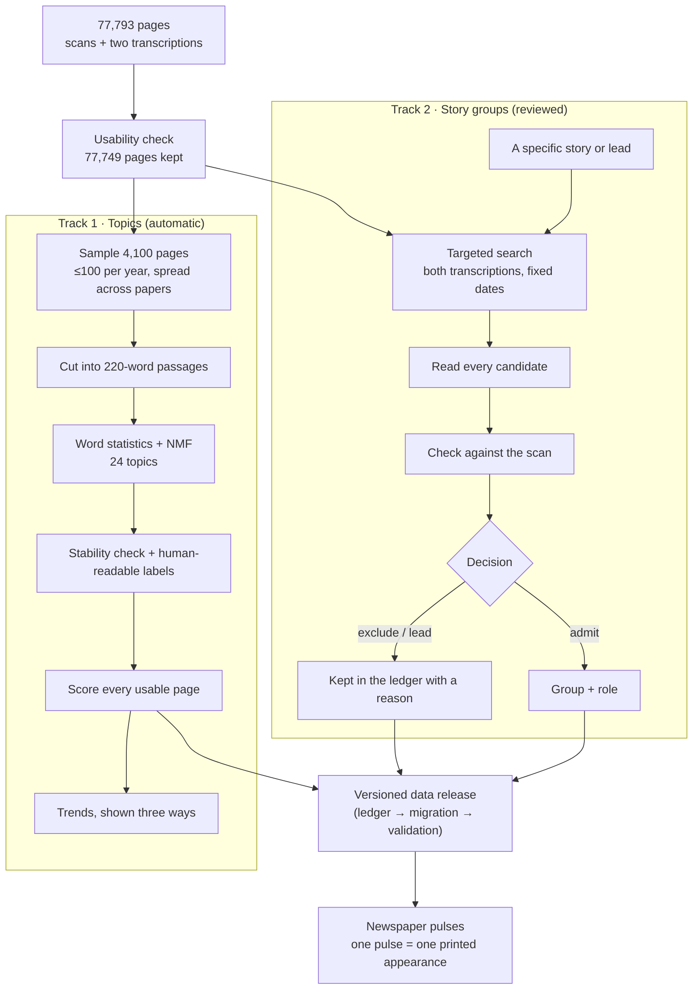

# How the newspaper data becomes topics, groups and pulses

*Process introduction · Project 02 · 7 November 2026*

This project works with 77,793 newspaper pages printed between 1770 and 1810: 110 newspaper series from the Library of Congress's Chronicling America collection, published on Hugging Face as part of the Smithsonian's Revolution Crossroads project. The pages arrive as scans with two machine transcriptions. One is the original Chronicling America OCR ("CA"). The other is a newer AI transcription ("RevX").

Two separate processes turn those pages into the things you see in the project:

- **Topics** are broad themes, such as *shipping and naval encounters* or *land sales*. A computer finds them automatically by grouping words that tend to appear together. They are good for long trends, but a topic is not an event.
- **Groups** are specific stories, such as *Captain Dunbar's report of being plundered by a French privateer*. They are found by searching for the story, reading every candidate, and checking each one against the original scan. The newspaper pulses are built only from these reviewed groups.

The two processes share the same page records, but neither feeds automatically into the other.

---

## Step 0 · Decide which pages are usable

- **Download:** we take a fixed version of the dataset (revision `0b97906…`), so results can be repeated exactly. All six data files are checked against their published checksums.
- **Usability rule:** a page is usable if one of its transcriptions has at least 200 words. RevX is preferred, and CA is the fallback. Exact duplicate pages are removed.
- **Result:** 77,749 of 77,793 pages are usable.

The audit also exposed a basic limit of the archive: coverage is very uneven. 1786 has 356 pages and 1808 has 4,466 as filed (4,060 by the dates the papers printed; see the Kentucky Gazette correction below). In 1785 and 1786 only two newspaper series survive. No series covers all 41 years.

**Why it matters:** if a theme looks bigger in one year, that can simply be because different newspapers survive from that year. Every trend in this project is therefore shown alongside the coverage behind it.

## Track 1 · Topics: finding broad themes automatically

**1. Sample.** Up to 100 usable pages per year are picked, spread evenly across the newspapers available that year. Within each newspaper the pages are chosen by a fixed random rule. The result is 4,100 pages covering all 41 years and all 110 series. Each page carries a weight, so the sample can later be scaled back to the real collection.

**2. Cut into passages.** A newspaper page mixes many unrelated items, so each page is cut into consecutive spans of 220 words. That gives 49,585 passages. These are fixed-length spans, not real article boundaries. About one page in five is held out so we can check later how the topics behave on text the model never saw.

**3. Find the topics.** Each passage becomes a list of word scores (TF-IDF): words that are frequent in that passage but rare overall score highest. A method called non-negative matrix factorization (NMF) then finds 24 recurring word patterns. Each passage gets a weight on each pattern. The settings were:
- Single words and two-word phrases.
- Words appearing in fewer than 12 passages, or in more than 65%, are ignored.
- Common filler words are ignored, including old printing forms such as *fuch* and *faid* (long-s misreadings of "such" and "said").

Nobody told the model what topics to look for.

**4. Check stability and add labels.** The model was fitted a second time from a different random start, and the two runs were compared.
- **Stable topics:** most reappear almost identically (median similarity 0.99).
- **Unstable topics:**
  - T16 *escape and capture-reward notices*: 0.04
  - T20 *Crown, Parliament and royal authority*: 0.20
  - T19 *letter extracts*: 0.50

  These are flagged and not presented as reliable.

Each topic was then labelled by reading its top words and example passages. This was AI-assisted, in Codex. The labels sorted the 24 topics into seven provisional categories, for example *politics and public institutions* and *war, diplomacy and shipping*. Some topics turned out to be formats rather than subjects, such as name lists or letter extracts, and they are marked as such. The names the site shows were revised later, against the matched stories (Track 3, "Topics").

**5. Score every page.** The frozen model was applied, without refitting, to all 77,749 usable pages: 1,063,079 passages in total. Re-scoring the whole collection instead of the sample changed the peak year for 12 of the 24 topics. That is a good reminder that the sample-based curves were only a first look.

**6. Show trends three ways.** A topic's share of the text in a year can be calculated against three baselines:

| Baseline | Question it answers |
|---|---|
| Whole collection | How much of the surviving text in this year is about the topic? |
| Each newspaper counted equally | Is the picture driven by one big paper? |
| Only papers present in both years | Does the change survive when the set of newspapers stays the same? |

These baselines can disagree. Between 1774 and 1775, political argument *falls* by 1.5 points in the whole collection but *rises* by 1.4 points among the three papers present in both years. The project shows such disagreements instead of picking one curve.

**What a topic share is not:** it is not how much society cared about something. It is not a count of articles, and it does not say whether a problem was solved. It is a share of the model's word signal in the newspapers that happen to survive.

## Track 2 · Story groups: following specific messages

Topics are too broad to follow one story through the papers. For that, the project uses a slower, reviewed process.

**1. Start from a specific story or lead.** Leads come from two places:
- **Close reading.** Examples: Captain Boyd's report that the French fleet at Bantry Bay "must inevitably be captured", and the seizure of the brig *Peace* at Cayenne.
- **Automatic text-reuse matching.** Code looks across all 1797 pages for passages in different newspapers that share long runs of wording, printed within 120 days of each other. Overlapping matches are grouped into candidate *families*: 629 in 1797, of which 23 reach 4 or 5 papers. The largest families are read first. That is how the report of the British defeat at Tenerife, Duncan's Camperdown dispatches and the Blount letter were found.

**2. Search for it in a fixed window.** Patterns for names and phrases are run over **both** transcriptions of every page in a set date range. For example, the 1797 search looks for "Bantry", "Boyd" near "fleet", and "brig" near "Peace", across all 1,587 usable pages from 1797. Both transcriptions are searched because each one misreads different words. The output is a candidate list, not a result.

**3. Read every candidate.** Most candidates are false hits. In 1797, 28 of 54 were another person named Boyd, or OCR noise such as "a bove" for "above". A candidate counts as the same message only if the actual wording corresponds. Sharing a place name or a date is not enough. When a real match turns up, a second search with its distinctive phrases looks for further printings.

**4. Check against the scan.** Each passage to be admitted is cropped from the original page scan and read. This step regularly changes the picture:
- RevX printed *distressed* where the paper says *dismasted*.
- RevX gave "65, 55" for a longitude printed as "65, 35".
- In one case RevX dropped a printed statement of about 350 words entirely.

Differences between transcription and scan are recorded as transcription errors, not as changes the newspapers made.

**5. Decide and record.** Every candidate gets one recorded decision with a reason:
- **admitted** to a group;
- **excluded**, for example as a false match;
- **lead**, for example a ship with the same name whose identity is unresolved.

Nothing is silently dropped. The decisions live in a ledger file, such as `pipeline/archive_data/ledgers/expansion_1797.json`.

**6. Choose the kind of group.**

| Group kind | Contains | Example |
|---|---|---|
| Message group | Printings of the *same* text | Boyd's fleet report in three papers |
| Context group | Different texts about the same matter | Hand-bill and summary of the Two Sisters wreck |
| Document group | Printings of a document | The 1794 clearance resolution |

A passage can belong to more than one group, and groups can sit inside each other. In the totals, each passage counts once.

**7. Label each appearance's role.** Examples are *report*, *appended challenge*, *later related account*, *condensed report* and *translated document*. A role describes what the printed text does. It is not a verdict on whether the text is true.

### A second reviewed year: 1776 (data releases v0.7.0 to v0.7.2)

The same steps were run for 1776, chosen over 1800 because more of its stories reached many papers and its coverage is steadier.
- **Splitting chains.** Most large automatic families of 1776 joined neighbouring items printed side by side. `pipeline/story_items.py` split them into single printed items and counted where each was printed, on all 2,319 pages of 1776 in both transcriptions. Phrase searches (`pipeline/story_phrase_search.py`) confirmed the printings.
- **Selection.** Every single item printed in 9 or more papers was admitted, except news digests. Items in 7 or 8 papers were chosen to cover January to November and the kinds of news. The result is 22 stories, 31 groups and 246 printings in 16 papers, from the King's speech of October 1775 to the Declaration of Independence and Congress's 88 battalions. Candidates not admitted are recorded, with reasons, in the ledger's `dispositions_summary` (`pipeline/archive_data/ledgers/stories_1776.json`).
- **Scan check.** Every printing was checked against its scan; 23 crops were placed by hand where the page's text layer failed. All 246 printings are on their pages. Of the excerpts, 171 transcriptions are faithful, 44 have minor errors and 31 have errors that change a fact. Every paper printed Congress's resolutions opening the ports with "ſtaves" (staves), and RevX reads "slaves" in eight of the nine.
- **Printed differences** are kept apart from transcription errors. Two papers head those resolutions "March 6" where the others have April 6, and Montgomery's letter to Carleton is dated 6 December in three papers and 16 December in four.
- **Topics.** v0.7.1 adds topic rows for the 31 new groups, from the same frozen model as the matched stories, so the telescope's Topic view can place them.
- **Round two (v0.7.2, 9 November 2026).** The ten candidates in 7 or 8 papers that round one read but did not admit were read again, item by item.
  - **Admitted:** 9 stories (15 groups, 87 printings in 10 papers). Among them are Wilkes's speech in the Commons, Governor Penn before the Lords, the Prohibitory bill, Barry's capture of the *Edward*, the Howe brothers' declarations and Gates on Carleton's retreat.
  - **Not admitted:** the Cork deserters' paragraph is in only 5 papers. Philadelphia committee notices that name people who refused Continental bills are left out. The Cherokee and Creek reports wait for careful framing.
  - **Small sub-stories kept:** three sub-stories in 5 or 6 papers stay, because their stories reach 7.
  - **Scan check:** all 87 printings are on their pages. 54 excerpts are faithful, 15 have minor errors and 18 have errors that change a fact. For example, Wilkes's "ill becomes" is read as "will become" in 3 of 8 printings. The Commons committee report prints the dates of the clause on captures as blanks, and the dates it expects turned out wrong.
  - **1776 now:** 31 stories, 46 groups and 333 printings. The round's findings and each printing's notes are in the data release.

### A third reviewed year: 1807 (data releases v0.8.0 and v0.8.1)

1807 was chosen because, after 1776, it has the most widely printed matched stories, and because it opens the embargo years. It was reviewed by the 1776 method, with one change: `pipeline/story_items.py --long-running` also takes candidates from long-running families, where several of 1807's most printed documents sit (the President's message of 27 October, the proclamation of 2 July, the Burr documents).
- **Release v0.8.0:** 14 stories, 32 groups (9 single stories; 5 parents with 18 sub-stories) and 250 printings in 11 papers, all checked against their scans.
- **Release v0.8.1, a correction** (`pipeline/archive_data/refile_revx_pages.py`): a check of the whole corpus found 133 issues whose RevX transcriptions are filed under the wrong page. v0.8.1 re-files the 532 matched printings that this put on the wrong page and merges 85 duplicate reads (163,841 printings now). No reviewed printing was affected.
- **On the site since 10 November 2026,** in three categories in the usual colour slots: *War in Europe* (6 stories), *Britain, France and American ships* (6, with the Chesapeake affair) and *American public life and government* (2: Burr's conspiracy and trial, and Congress called early).

### A fourth reviewed year: 1808 (data release v0.9.0)

1808 is the embargo year. It was reviewed by the same method, with the change made for 1807. Two AI reviewers chose the stories, each for half of the year, and AI reviewers checked every printing against its scan. `pipeline/story_items.py --long-running` was also run with the year 1807 over the 1808 pages, because the embargo acts and the papers laid before Congress in March sit in families that begin in 1807.
- **Release v0.9.0:** 20 stories, 50 groups (11 single stories; 9 parents with 30 sub-stories) and 298 printings in 10 papers. Counted item by item, only one item reaches 9 papers: the President's message of February on more troops. Seven sub-stories have 5 or 6 papers, under parents that reach 7.
- **Scan check:** all 298 printings are on their pages (2 only partly shown). 201 excerpts are faithful, 71 have minor errors and 26 change a fact, for example "exceptional" for "exceptionable", "Juan" for Junot and "towels" for "fowls". Printings on pages whose RevX text is stored under another page use the scan page and the Chronicling America text.
- **A dating error found:** the *Kentucky Gazette* issues filed under 1808 print 1806 in their mastheads. The correction is below.
- **On the site since 10 November 2026,** in three categories: *War in Spain and Portugal* (7 stories), *Britain, France and American ships* (4) and *The embargo and American government* (9, from the embargo laws to the charges against General Wilkinson).

### A fifth reviewed year: 1793 (data releases v0.10.0 and v0.10.1)

1793 fills the gap between 1776 and 1797. Fewer of its papers survive: 6 to 8 at a time, 4 to 6 from October, and no Philadelphia paper after 26 October. Only ten items reach 7 papers, and none reaches 8. So the bar for 1793 is 6 papers, agreed with the project's owner after round one. Candidates came from families in 3 or more papers.
- **Round one (v0.10.0, 7 papers):** Dumouriez's letter on entering Brussels; his defection (four sub-stories, among them Clairfayt's letter and Saxe-Cobourg's proclamation); Genêt and the President (Genêt's letter of 13 August, Jefferson's answer, and Jay and King's statement); a Brussels paragraph on the emigrant princes' armies; the brig *Molly*'s report from Madeira of a battle near Lisle; and Captain Crabtree's sea serpent.
- **Round two (v0.10.1, 6 papers):** the list of the powers at war with France, the London Gazette's bulletin from Tournai of 3 May, the commissioners' letter on General Dampierre's death, the Convention president's declaration of a plot, a letter from Cadiz of 24 June, and Hamilton's circular with the President's rules on neutrality.
- **In all:** 12 stories, 19 groups and 111 printings in 9 newspapers, every one on its page. 64 excerpts are faithful, 40 have minor errors and 7 change a fact: RevX leaves out text in four printings and reads "June 23" for 24, "General Dumourier" for Dampierre and "parts" for "ports". It also corrects printers' misprints without a sign: all seven papers printed "Andersecht" for Anderlecht.
- **Filing errors, recorded and not corrected:** two *Gazette of the United States* issues are filed under the wrong dates (4 April for 4 May, 23 July for 13 July), and the pages filed as 3 and 4 of the *American Herald of Liberty* of 2 July are a second scan of 9 July. No reviewed printing uses them.
- **On the site since 10 November 2026,** in three categories: *The war in Europe* (9 stories), *Ships and the sea* (2: the sea serpent and the rules on neutrality) and *American public life* (1: Genêt and the President).
- **Left out for framing:** the treaty commissioners' report, a letter on the German Creek raid, the Saint-Domingue reports, the Fugitive Slave Act and the Henfield prosecutions.

### Corrected dates: the Kentucky Gazette (data release v0.10.2)

A check of every issue of the *Kentucky Gazette and General Advertiser* found 106 filed two years late: 98 of 1806 filed under 1808, 7 of late 1804 under 1806 and 1 of 1805 under 1807. Release v0.10.2 (`pipeline/archive_data/redate_issues.py`) dates them as printed: 91 by their mastheads, 13 by the two-year rule where the masthead cannot be read or reads wrong, and 2 read on the scans.
- **Ids keep the filed date,** because they are the keys of the source rows and of the scan files. Each change is recorded with its old value and its evidence.
- **Years:** 1806 now has 4,381 surviving pages, the most of any year, and 1808 has 4,060.
- **Matched stories:** the pages were matched again in the windows of their printed dates, by the same rules. Their 95 old matches gave way to 4,506 new ones; 27 printings left and 884 joined, 390 of them in 151 new stories. In all there are 48,270 matched stories and 164,698 printings. No reviewed story changed.
- **On the site,** a printing's date is the date it printed; its scan link still uses the filed one.

### A sixth reviewed year: 1806, and the stories once held back (data releases v0.11.0 to v0.11.4)

1806 was reviewed by the method of 1807 and 1808 (every single item in 9 or more papers, items in 7–8 papers chosen to cover the months and the kinds of news): 33 stories, 66 groups and 464 printings in 12 papers, all found on their scans, from the news of Austerlitz and the Treaty of Pressburg to Miranda's expedition, the *Leander* affair, the return of Lewis and Clark and Burr's enterprise (release v0.11.0, 1,793 checks). Stories that turn on private persons were left out for the owner to decide, as before.

Four rounds then read the stories earlier rounds had held back for framing, by each year's own rule and described like every other story (what kind of text it is, whose account, in the papers' words): 12 stories and 96 printings in 1776, 1793, 1807 and 1808 (releases v0.11.1 to v0.11.4, 1,894 checks). Among them are letters about the Creek and Cherokee towns, the War Office report on the treaty talks north of the Ohio, the German Creek letter, news from Cap Français and from Haiti, and Robert MacDonald's funeral at Norfolk. What did not reach a year's rule stayed out by the rule, not for its subject. Their categories say what kind of affair a story is, not whose affairs: 1793's first category became "War and diplomacy", 1807's "War in Europe and Haiti" and 1808's "War and conflict".

### Connections between stories

Connections were found the same way: search, read, then record. Passages in which two topic groups are both strong, for example shipping and European politics, were read. Fifteen connections that the newspapers state themselves were recorded, such as a decree that cites American newspapers. Each connection is recorded with its type (citation, challenge, claimed cause and so on) and the passage that supports it. Four counterexamples were kept as well, where items merely sat next to each other on a page. A connection a newspaper *asserts* is recorded as an assertion. It does not prove that one thing caused the other. Plainer links are recorded too. For example, a Greenock letter and Boyd's Bantry report were printed side by side in the same three issues, after arriving on the same ship. That is recorded as `printed_alongside` and nothing more.

## Track 3 · Matched stories for every year (automatic, not checked)

Reviewing every story by hand cannot cover 41 years, so coverage comes in two tiers:

| Tier | What it is | Checked against scans? | Where |
|---|---|---|---|
| **Reviewed stories** | Read, grouped by hand, every printing checked on its scan | Yes | Data release tables (observations, groups) |
| **Matched stories** | Found automatically: passages in different newspapers that share long runs of wording | No | Data release derived tables (`reuse_*.parquet`) |

**How matched stories are made:**
1. The text of every usable page is turned into overlapping 5-word fingerprints, the same method used first for 1797.
2. Pages from different newspapers that share many fingerprints, and were printed within 120 days of each other, are compared word by word. A match needs at least 80 corresponding words with 70% similarity.
3. Matches that overlap on the same page are joined into one *matched story*, a family.
4. Each year is processed with a 120-day look-back, so stories that cross a new year are not lost.

**The matcher takes the transcriptions as they are.** It finds what the database's text supports. A matched story can still join two neighbouring items on a page, and printings with badly damaged transcriptions are missed.

**What the first run found (run `run:reuse-all-v1`, data release v0.5.0):**
- 310,155 matches across all 41 years, from 77,749 pages;
- 48,127 matched stories with 179,966 printed appearances;
- 32,870 of these stories are in two newspapers, 8,549 in three and 6,708 in four or more (the largest reaches 15).

Later releases change these counts: from v0.6.0 each printing counts once per page (163,926), v0.8.1 re-files printings whose transcription was stored under another page (163,841), and v0.10.2 dates the misfiled Kentucky Gazette issues as printed (48,270 stories and 164,698 printings).

**Titles (data release v0.5.1).** The shared wording often starts a few words into a sentence, so each matched story's title is read from the text printed just before it:
- It starts where the item starts, if that is within 30 words. This works for 98% of a 300-story sample and 94% of all 48,127 stories.
- A dateline place is added in front when 2 or more printings agree on it, as in "France · You would be astonished…". That happened for 20% of the sample and 8% of all stories.
- Headings above the item are not used, because they were often section names or the signature of the item before.

**Topics (data release v0.5.2).** The frozen 24-topic model from Track 1 scores the excerpt of every printing, and each story takes its strongest topic. Printings of the same story share their story's topic 89% of the time across all stories with two or more printings, and 76% in a sample of stories with three or more; chance would be about 7%. The telescope's Topic view uses these topics.

The site names each topic for what the stories in it mostly are. A check of 810 matched stories, read without knowing their topics (12 November 2026, `docs/notes/2026-11-12-topic-labels-review.md`), found that the first names fitted about half of the stories in their wedges. Those names had been given from whole pages, where advertisements are common, while reprinted stories are mostly news, so names of kinds of notice fitted few of them. The names were changed to those that fitted best in the same kind of test, for example *Courts and lawsuits* for *Court orders* and *Notices seeking people* for *Escape and capture notices*. Two wedges whose stories share only place names or personal names are called *Mixed*. Two topics that hold the same estate and debt notices share one wedge, so the ring has 23 wedges. The data release keeps the model's 24 topics and its first labels.

**Long-running matches.** Overlapping matches can chain a serial document or a long debate into one family that runs for months, for example Erskine's instructions in 1809–10 (330 pages in 12 newspapers). A family that spans more than 120 days or more than 40 pages is flagged `long_running`. The pulse page lists these separately and leaves them out of the year overview.

**On the pulse page, matched stories appear under "Matched automatically · not checked",** in one neutral colour, with a link to the original page instead of a scan crop. A **Year** menu switches between 1770 and 1810. Each year shows the matched stories that *start* in that year, so a story begun in December can run into January.

**Checks of the matched stories (data release v0.6.0, 8 November 2026).** Matched stories are not read one by one, so they were checked in two ways, and the results are stored in the release.
- **One printing per page** (run `run:printings-merge-v1`). The matcher had listed some pages more than once for a story: overlapping matches with different partner pages, or separate blocks of one page, such as neighbouring items of a news digest. 3,945 stories listed 11,400 pages more than once. Each page now counts once, so the 179,966 appearances became **163,926 printings**. Newspaper counts did not change.
- **Every printing, by machine** (`pipeline/transcription_check.py`, run `run:transcription-check-v1`, `derived/transcription_checks.parquet`).
  - Each page has two machine transcriptions, RevX (AI) and CA (Library of Congress OCR). The check asks whether a printing's passage also appears in the page's other transcription. It counts shared 4-word sequences, compared with how well the two transcriptions agree on the rest of the page.
  - 81.0% of printings are confirmed, 5.4% partly, 2.3% missing from the other transcription although it reads the rest of the page, 10.5% unreadable in the other transcription, and 0.8% have no second transcription.
  - 97.7% of stories have at least one confirmed printing. The pulse page states each printing's result in words.
- **200 stories, against the scans** (`pipeline/audit_matched.py`, run `run:matched-audit-v1`, `derived/matched_audit.parquet`; the protocol, verdicts and crop list are kept in the release's sources). The stories were drawn at random (seed 20261108). Eight AI reviewers read every printing side by side and compared one printing per story with its scan crop. Their verdicts were harmonised under one written rule (`PROTOCOL.md` version 2), and a blind second reader re-judged 30.
  - **One item:** 86% (two-paper stories 91%, three or more papers 75%).
  - **On the page:** every one of the 187 located passages.
  - **Misreadings:** about 1 passage in 5, up to 1 in 3, has a misread word that changes a fact or the sense, such as "persecution" for *perfection*, "2,500" for *3,500*, or "failed" for *ſailed*. The machine check does not catch these: confirmed printings were misread about as often as the rest.
  - So the pulse page carries a standing caution: check the scan before quoting a matched passage.
  - The reviewers were AI assistants, not an independent human reading.

**English notes (data release v0.6.1).** The 6 relation reviews and 16 date roles still in Chinese from the first pilots are now in English. The annotations are superseded; the date roles change in place, with the old values kept in the metadata (`apply_corrections.py`, `ledgers/corrections_2026-11-08.json`).

## From reviewed data to a data release

New decisions never overwrite old ones. Each round of review becomes one release:

**ledger** (the decisions) → **migration script** (applies them to the previous release) → **validation** (automated checks of counts, links, scan files and double counting: 66 for the first reviewed release, 190 for v0.6.1, 449 for v0.7.1, 1,263 for v0.10.2) → **frozen release** ([`data/`](../data)).

Earlier releases stay unchanged, so any chart can say which version of the evidence it uses. Corrections follow the same path. For example, v0.2.1 fixes one note that undercounted the length of the dropped statement. It adds a corrected annotation that points back to the old one, and the old one stays in the history.

## From groups to pulses

The pulse view is a direct translation of the admitted group records:

- **Each newspaper is a fixed point, placed by its town of publication.** 1797 has 8 newspapers in the collection, and 1776 has 16.
  - The town comes from the catalogue record (`places_json`), and its coordinates from a short table in `pipeline/build_pulse_explorer.py` (32 towns).
  - North is at the top and east to the right. Crowded coastal towns are spread out, and papers are nudged apart so names stay readable, so the layout keeps the order of places but not distances.
  - Papers from the same town sit side by side.
- **Each admitted passage is one pulse,** placed at its newspaper on its publication date. The same story in three papers makes three pulses. If one paper prints it twice, both printings pulse.
- **Colour shows the passage's role** (report, challenge, later account, document). It does not show truth or a historical phase.
- **There are no copying lines between newspapers.** We show where and when a story appeared, not who copied whom. Most printings name no source, so copying routes are unknown.
- **Seeing which pulses belong together:**
  - *Resonance:* when a paper prints a story, the papers that printed the same story in the previous 40 days glow again at the same moment. Nothing travels between them.
  - *Constellations:* hovering over or tapping a star pauses on its story. The story's papers light up with their printing dates and are joined by faint lines; everything else dims. The lines join nearest neighbours on the map, not printings in date order, and appear all at once, so they group the printings without suggesting a route. The caption says so.
  - *Filter:* "Show stories printed in at least N newspapers". The matched overview defaults to 3, which removes the two-paper matches (68% of all matched stories).
- **Choosing what to follow (9 November 2026).** Nothing is hidden in menus; the page offers what there is.
  - *Years:* a strip of 41 slots, 1770–1810, drawn like the telescope's timeline. Each slot has a bar for how many newspapers survive that year, and a gold dot marks each reviewed year, 1776, 1793, 1797, 1806, 1807 and 1808. The chosen years sit in the same pale blue bracket as the telescope's look-back. Tap a year, drag across several, or choose All. A view of many years opens on all its matched stories (a reviewed year on its own opens on its reviewed stories) and puts every newspaper of those years on the map, with smaller markers.
  - *Story shelf:* the stories of the chosen years as cards above the map: the overviews (one for each reviewed year in view, and one for the matched stories), the reviewed stories under their year, then the matched stories (most widely printed first, or earliest first), and the long-running ones. Each card gives the reach, the dates and a row of dots for when it was printed.
  - *Topics and words:* topic chips hold the seven families of the project's topic model. A family chip chooses the whole family and opens its topics, 23 in all, as a second row to choose one by one; a family with only some topics chosen shows a half light. A find box narrows the stories by the words of their titles. Topics and words narrow the shelf and the map's overview together, so choosing "War" plays every war story of the chosen years.
  - *Speed:* Slow, Normal or Fast, as a sliding glass control (six steps until 12 November 2026). Their meaning follows the chosen years, so Normal plays them in about half a minute: for one year, a week, two weeks or a month of printing per second; for all forty-one years, four months, a year or two years. The button's title gives the exact value, and a link can still ask for an exact speed (`speed=7`, used by the exhibition).
  - *Tour:* the page plays on its own, the current view and then the next card on the shelf. Any click, tap or key holds it for 20 seconds; an open passage or scan holds it while it is read.
  - *Data:* one slim index of all years (`years/index.json`, 8.8 MB, 2.3 MB compressed) holds the newspapers, stories, printings and surviving pages; a passage loads from its year file when it is opened. The reviewed stories of 1776, 1793, 1797, 1806, 1807 and 1808 show at once, before the index arrives.
- **The archive coverage display shows which dates have pages at all.** A dark newspaper can mean the paper printed nothing on the story, or that its issues for those dates did not survive.
  - Under each newspaper: whether the archive has a page from it on the current date.
  - A coverage strip above the date slider: for each week (each day in short views), how many of the newspapers on the map have surviving pages. A low or missing bar is a gap in the archive, not silence.
  - Weeks are used because most papers were weekly. Counted by single days, most days would look empty.
- **Each reviewed year has its own overview, "All reviewed stories of 1776", "… of 1793", "… of 1797", "… of 1807" or "… of 1808", which plays all its top-level stories together.**
  - **Categories and colours:** each year names its own three categories, one colour each. Three colours is the most that stay distinguishable, including for colour-blind viewers, when any two are on screen together. So the colour shows the category, and the story's name appears under the newspaper.
    - 1776 (31 stories): *war and the armies* (11), *Britain and Europe* (9) and *independence and American government* (11).
    - 1793 (12 stories): *the war in Europe* (9), *ships and the sea* (2) and *American public life* (1).
    - 1797 (21 stories): *war, revolution and foreign news* (8), *ships, privateers and wrecks* (5) and *American public life* (8).
    - 1807 (14 stories): *war in Europe* (6), *Britain, France and American ships* (6) and *American public life and government* (2).
    - 1808 (20 stories): *war in Spain and Portugal* (7), *Britain, France and American ships* (4) and *the embargo and American government* (9).
    - The years share the three colours: blue is always war, green American public life and government, and orange Britain and Europe in 1776 and ships and the sea in the later years. An overview plays one year, so two years' categories never share the map.
  - **Fading:** a newspaper keeps the colour for 40 days after a printing, then fades.
  - **No double pulses:** each passage belongs to exactly one top-level story.
  - **A sample, not a census:** the overview shows only reviewed stories, a small part of what the papers printed, not every story of the year.

## The story telescope

**Version 2 (7 November 2026)** treats time like looking into the night sky: **the further away, the earlier.**
- **Time and depth:** the front frame is "now"; earlier stories sit further back. "Look back" sets how many years deep you see. The timeline bar, the Earlier/Later buttons and the arrow keys travel through time.
- **Drift:** lets time pass slowly. New stories arrive at the front and older ones recede into the distance.
- **Three views of the same tunnel of time**, with the stars gliding between them:
  - **Place:** the town where each story was first printed in this archive, on a face-on map.
  - **Topic:** a ring of the project's topics (23 wedges; two of the model's 24 topics share one), each named for what its stories mostly are and grouped into seven families, with a gap between families. A star sits on its topic's middle line when the story is about that topic alone, and leans toward its next topic when it mixes topics. Stories in more papers sit toward the rim. Printings of the same story agree on the topic 89% of the time. The hover card gives the topic's name with its three most typical words. For a topic whose name fits mainly the 1770s (notices seeking people, horse notices, estate and debt notices), it adds one line saying so.
    - The families are not used for colour. A spot check of matched stories in three or more papers found that only 2 or 3 of 14 "notices" were notices and 4 of 14 "other" were poems or essays; the rest were news. Advertisements were rarely reprinted across papers, and the model goes by vocabulary, so fire and bridge reports land among the property notices.
  - **Orbit:** a ring of the calendar. Because time also runs into the distance, each year becomes one turn of a spiral, so stories that return at the same season line up as streaks. A check found strong yearly rhythms for Independence Day, Thanksgiving, the President's annual speech, ice, fever and Congress, and none for fires; see [the seasons check](seasons-check.md).
- **Angle:** Front looks straight back through time; Side shows the time axis from an angle.
- **Moving around:** drag to turn the view, right-drag (or two fingers) to move it, and scroll or pinch to zoom. "Reset view" brings back the whole picture.
- **Timeline bar:** under the view, a full 1770–1810 bar shows how many stories each month has, and which stretch of time you are looking through.
- **Search:** typing a word lights up every story that mentions it in its title or opening words, in gold. The other stories turn fainter but keep their size, because a star's size always means how many newspapers printed it. The caption says how many match, in which years, and whether they keep to a season.
- **Compare (8 November 2026):** "vs" between up to three searches gives each its own colour (amber, blue, magenta; a white star mentions more than one). The timeline shows each year's share side by side, Orbit draws each search's months as a line, and ready-made comparisons sit among the suggestions. A colour means only that the words occur, so no classifier can be wrong about it.
  - We chose this after two other ideas failed their checks. Colouring by kind of item (from the topic model) mislabelled most notices. Colouring by where the news came from, read from datelines, works for only about 1 story in 10. Where it does work, European news was a median 65 days old when first printed here, Caribbean news 32 days and American news 6.
  - France · Britain · Congress shows the clearest history: Britain leads the 1770s, France reaches 45–46% of stories in three or more papers in 1793, 1796 and 1798, Congress peaks in 1789 (29%), and Britain returns in 1807–09.
- **Controls:** each single-choice setting is a sliding glass control: tap an option, drag the thumb, or use the arrow keys. On/off buttons (Drift, the kinds of story and the Try suggestions) are separate glass capsules with a small light, lit when on. The suggestion of the current search is lit, and tapping it again clears the search. Every setting can also come from the address, for example `telescope.html?view=topic&lookback=5&angle=side&colour=off&min=4&year=1797&drift=off`, so a view can be linked or scripted.
- **Colour: one control, Region · Search · Off,** so a colour on screen only ever means one thing. Off is the default since 9 November 2026: in the Place view a star's position already says where its story was first printed, so region colours only repeated it. Region is there for readers who choose it. A search switches it to Search (gold, or a colour per compared search). Choosing Region or Off keeps those colours, and the matches then show as the bright stars, all searches together; the caption says so.
  - Stars keep the same size in every colour mode. Coloured stars are drawn with a steeper glow than plain ones, measured on screen within about 6% of a plain star's width. Before this, region stars were drawn up to 1.3 times as wide, single-search matches 1.5 times and compared matches 1.8 times.
- **Region colours:** each star takes the region of the town where its story was first printed in this archive.
  - Violet is New England, aqua the Middle States, and orange the South and West (Washington, Virginia, Kentucky and South Carolina).
  - Three hues is the most a scatter can carry and stay distinguishable for colour-blind readers; the three were checked on the telescope's background.
  - The colours show the shape of the archive: in the 1780s and 1790s most stories were first printed in the Middle States, and after 1800 most in the South and West.
  - Region colours are drawn one over another, not added, so overlapping regions never mix into a false colour.

Version 1 (below) is kept as `telescope-v1.html`.

`telescope.html` shows every story at once as a field of stars: 48,127 matched stories plus the 21 reviewed ones (48,270 and 98 since data release v0.10.2; 143 reviewed since v0.11.4).

- **Left to right:** the date of first printing.
- **Up and down:** the average latitude of the towns whose papers printed the story, north at the top. A small fixed scatter, up to 0.12°, keeps stories printed by the same papers from stacking into a line.
- **Size and brightness:** the number of newspapers.
- **Colours:** reviewed stories keep their category colours, and matched stories are grey-blue and labelled "not checked".
- **Moving around:** zoom and pan through time. The latitude axis fits the stars in view.
- **Opening a story:** click a star (or tap it twice on a phone) to open it in the pulse view with its printings and passages.
- **Accessible list:** a "Brightest stories in view" list gives the same stories as plain links.
- **Reading it with care:** the field follows the surviving archive. Where few papers survive (for example the South, or 1785–86), there are few stars. That is a gap in the collection, not proof that nothing was printed.

### One population of stories (11 November 2026)

Reviewed stories and matched stories used to be shown as two separate worlds, so a story found both ways appeared twice: once as a checked star and once as an automatic one. The build now pairs each reviewed story with its *twin*, the matched story that holds at least half of its printings on the same pages. 85 of the 98 reviewed stories have one, and six matched stories are the twin of two reviewed ones (the computer joined items the reviewers kept apart).

- The sky draws each pair once, as the checked star: 48,289 stars instead of 48,368.
- A link to a twin opens the reviewed story, on the telescope and on Pulses, and the Pulses shelf lists the story once.
- The telescope's "Reviewed / Matched" switches became one, **Checked by hand only**, because the checked stories are a small marked part of the stories found, not a second set. Long-running texts, all found automatically, step aside with the rest.

### Watch mode (11 November 2026)

A **Watch** button on the telescope and on Pulses turns the current view into the exhibition's look in place, full screen and without controls: the sky drifts, or the stories play one after another. Esc, or Exit in the corner, brings the controls back as they were; `?watch=1` opens a link in it.

### Select, then act (11 November 2026)

A click on a star used to mean two things: with the radio off it left for Pulses, with the radio on it added a voice. Now a click always *chooses* the star. Pointing previews it; the chosen star's card stays beside it, so its facts no longer depend on hovering. The card offers three actions:

- **Hear:** the announcer's town and date, then the recording. With the radio off it plays on its own; with the radio on, choosing a story already plays it in full.
- **Follow it in Pulses:** the story paper by paper (a double click does the same).
- **Trace a word:** up to three words of the title, each with its number of stories. A tap runs the telescope's search on that word: its stories light up, with their yearly shares and season.

The words offered are not simply the rarest. The build (`trace.json`) keeps a title word only when the stories that mention it are spread over the years, or over the months, unlike the archive's stories as a whole (a G-test against all stars, p < .001). A word spread like the archive would only retrace how much of the archive survives, the coverage problem this project keeps apart from attention. A check of 30 stories showed why the test matters:

- Ranking by rarity alone offered words such as *favored*, *recently* and *perusal*.
- With the test, the first word offered was a fitting theme in most cases: *privateer*, *Havana*, *Lisbon*, *Nelson*, *Claiborne*, *Ratisbon*, *Hawkesbury*.

Of all stars, 95% offer at least one word. A word can still have two senses (Captain *Snow* and snow), which the matches show.

Pulses has the same actions under its map. Hear reads the printing chosen now, and the trace words open the sky with that word traced and the story chosen.

### One time window (11 November 2026)

The telescope's timeline showed the stories in the sky, but not the archive behind them. A thin stretch of sky could therefore be read as a quiet time when it was a gap in what survives, the coverage problem this project keeps apart from attention.

- **A second row.** The timeline now shows, under the stories by month, the newspapers that survive each year in this archive, with a gold dot for each year checked by hand. Each row has its own scale.
- **The same bars as Pulses.** These are the bars of the Pulses year strip. Both pages draw the stretch in view as a bright bracket and the moment ("now", or the date the pulses have reached) as a bright line.
- **Naming the year.** Pointing at the telescope's timeline names the year under it: its surviving newspapers and pages, and the stories in the sky first printed that year.

Each page keeps its own way of moving through time: the telescope moves "now" (Drift moves it on its own), and Pulses chooses years and plays them.

### Waves (11 November 2026)

The project began with the question of whether problems keep coming back. A scan of cycle lengths (`pipeline/check_cycle_lengths.py`) found that the year is the only fixed cycle in this archive. A week shows only the printing days, and the other peaks are echoes of the year. Many things come back irregularly instead, in waves.

The telescope's search now says how a word comes back, for example "comes back in waves: 1794; 1796; 1798; 1801; 1808–1810" for *embargo*. A gold line over the timeline marks the wave years.

- **Thin years:** a year is judged when it holds at least a fifth of a typical year's stories in view. Thinner years are named "too little archive to judge", never quiet.
- **Wave years:** a wave year has at least 3 matches, twice the word's usual share, and more than chance would give (P < .05).
- **Checked against known history** (`pipeline/check_waves.py`, [the waves check](waves-check.md)). The rule found the Tripoli war (1801–1805) exactly, both US embargoes, the Algiers crisis of 1793–1797 and the great fever years.
  - **The extra embargo waves are European crises** (1796, 1798, 1801). The rule traces the word, not the policy.
  - **Fire, the control,** shows at most one borderline year.

### Findings (11 November 2026)

The site offers more than its instruments. In the owner's words, it is also rigorous research with results, storylines assembled from what the papers printed, and the story of how it was made. The first of these now has a page of its own: **Findings** (`findings.html`, in the menu after Stories).

**What each finding gives:** its claim in plain words, one chart, how sure it is, what it does not say, and doors into the instruments. The source comes first, because every other finding stands on it:

1. **A thin sky is a gap in the archive, not silence.** 1784–1786 have 5, 2 and 2 surviving newspapers.
2. **About one passage in five has a misreading that changes a fact.** This comes from the 200-story audit, with a range from the reviewers' own calls to the strict rule.
3. **The Declaration reached 14 newspapers in 21 days.** Every printing is shown as a dot.
4. **The embargo came back with every crisis.** These are the waves.
5. **Fever came back each late summer; fire kept no season.**
6. **The year is the only cycle this archive keeps.** This is the scan of every cycle from 6 to 400 days.
7. **Every four years, from 1800.** These are election stories by year: a pattern to read, not a tested cycle.

**The rest of the page:** open questions (false news has no denominator; who copied whom; a printed share is not attention; why things come back), and links to the checks and the earlier reports.

**Where the numbers come from:** the build computes them each time (`pipeline/findings_parts.py`). It uses the sky's stars, the year index, the Declaration's printings, the audit's summary and the cycle-length check's output (`check_cycle_lengths.py` writes `cycle_lengths.json`). None is typed by hand.

**Charts:** inline SVG with a tooltip on every mark and the numbers in a table under each chart. Gold marks what a finding is about and slate the rest, as on the telescope's timeline.

### Notebook (11 November 2026)

The last of them, the story of how the site was made, has a page of its own too: **Notebook** (`notebook.html`, in the menu after Findings) tells it as it happened.

- **Phases:** beginnings; building the instruments; generosity and care; voices, reviews and the archive's own errors; rethinking.
- **Entries:** each is dated, with its kinds (decision, wrong turn, difficulty overcome, care, discovery, encouraging moment, purpose, frustration), what it changed (links into the site) and its source.
- **The maker's words:** quotes appear in gold, as written. A filter shows one kind at a time, such as only the maker's words or only the wrong turns.

**The ledger:** the entries live in `pipeline/notebook.json`, written as the work goes on rather than from memory later. The build (`pipeline/notebook_parts.py`) renders the page and checks every entry: a known phase and kinds, date order, a quote only under the kind "words", and links that open pages of the site.

### Stories (11 November 2026)

The second of them, storylines assembled from what the papers printed, has a page too: **Stories** (`stories.html`, in the menu after Radio). A storyline puts the printed pieces of one affair in the order the papers printed them. The first is the Chesapeake affair of 1807: eleven pieces in six acts, 101 printings in 10 newspapers, from the account of the attack (26 June) to the verdicts of November. Each piece is a reviewed story of 1807; together they are the sub-stories of three parents (the Chesapeake affair, Commodore Douglas and the Mayor of Norfolk, and Congress called early). The second (12 November 2026) is the King and Congress in 1776, in their own words: eleven pieces in six acts, 94 printings in 16 newspapers, from the King's speech of October 1775 (printed in January) through the Commons on the bill to stop American trade, Congress's resolutions and the Declaration, the King's closing speech and his commissioners' offers of pardon, to the meeting on Staten Island and the commissioners' declaration of 19 September. Its chart shows how long news took to reach these papers: two to three months from London for the King's speeches and the Commons (56 to 81 days), one or two days for Congress's resolutions.

- **Each piece:** what it says; its opening as one paper printed it, beside the scan; how the papers set it (headings, lead-ins, changed words), from the scan check's notes; and every paper that printed it, with a door into Pulses.
- **Each act:** a short paragraph that uses only what the papers printed; at most one note on the machine's reading (in Act III, the Norfolk heading "WAR INEVITABLE!!!", which the machine transcription reads as "NECESSARY INFORMATION!!"); and doors into Pulses, the telescope and the radio.
- **Perspective without guessing:** the commodore's letters and the town's answers are set side by side, because they answered each other in print. The other perspectives are the papers' own settings. Nothing says who copied whom.

**The ledger:** the storylines live in `pipeline/stories.json`, written by hand. The build (`pipeline/stories_parts.py`) checks each one against the data release and the scan verdicts before rendering it. The pieces must be the sub-stories of the named parents and the named single stories, told whole. Each opening shown must come from a printing located on its scan with a faithful transcription. Every phrase in quotation marks must appear in a printing, in the group's reviewed description or in the scan check's notes on that printing. Dates and counts in the paragraphs are filled from the data, and each door must open a reviewed story. Pulses and the telescope link every story a storyline tells ("Read the storyline").

### Home: one question (12 November 2026)

Home follows the order in which a visitor comes to understand the site, without becoming a form. Below the stars it asks one thing, "What do you want to see?", and each of its six answers opens the instrument and the arrangement that show it: where a story started (the telescope's Place view), what it was about (Topic), when in the year (Orbit), how it spread (Pulses), how many over time (the telescope from the side) and what a day sounded like (Radio). Everything else is chosen later, on the instrument, when it changes what is seen.

Before any pattern come three facts about the source, shown as facts: what the archive is (110 newspapers, 77,749 pages), how much of it survives each year (a small bar chart; two papers for 1785 and 1786), and the two kinds of evidence (found by machine, or read against the scans by hand), with how often the machine's reading changes a fact. Then the findings about what came back and how a story travelled, each with a door into the view that shows it; the Chesapeake storyline; and the notebook. The page is written by `pipeline/home_parts.py` from the build's own numbers and the Findings page's titles and doors.

### What we found wrong in the archive (12 November 2026)

Reading the papers against their scans turned up errors in the archive itself, which the people who built the dataset may want to correct at the source. `pipeline/archive_errata.py` gathers them from the checks' evidence and the reviewed years' scan verdicts into two tables, [`filing.csv`](archive-errata/filing.csv) (242 issues: 133 with transcriptions filed under the wrong page, 108 filed under the wrong date, 1 second scan filed under another day) and `transcription.csv` (111 reviewed printings whose transcription changes what was printed, 28 of them by leaving printed text out), with a README. The Findings page sets them out in plain words (`findings.html#archive`), and the public repository carries the tables in `docs/archive-errata/`.

## The website

The views are joined into one site with nine pages and a shared header, plus an exhibition page:
- **Home** (`index.html`): a slow time tunnel of stars, then one question, "What do you want to see?", three facts about the source, the findings as ready views, a storyline and the notebook (above).
- **Telescope** (`telescope.html`): every story as a star.
- **Pulses** (`pulses.html`): one story or one year, paper by paper.
- **Radio** (`radio.html`): the newspapers read aloud, day by day (below).
- **Stories** (`stories.html`): storylines from the reviewed papers, each piece beside its scan (above).
- **Findings** (`findings.html`): what the archive shows, tested (above).
- **Notebook** (`notebook.html`): how the site was made, as it happened (above).
- **How it works** (`method.html`): the method in plain language.
- **Research notes** (`notes.html`): the earlier studies.
- **Exhibition** (`exhibit.html`, linked from the footer): a self-running loop for a large screen (below).

A first visit to the Telescope or Pulses shows a three-line hint, once per browser (12 November 2026): on the Telescope, drag to turn, slide the timeline to travel in time, click a star to open its card; on Pulses, what lights up, where to pick a story, and that a newspaper opens its passage. It never blocks a click, any touch, key or wheel hides it, and it never shows in an exhibition or in Watch.

The header and footer come from one file, `pipeline/site_parts.py`, so they cannot drift apart. The header's search box searches every story in the telescope. The pages link to each other where it helps: a story on the pulse page has "See it in the sky", a star in the telescope opens its pulses, and a story that a storyline tells has "Read the storyline". The public repository is made from this project by `pipeline/export_public_repo.py`.

**Accessibility (9 November 2026).** An audit of every page checked names, labels, contrast, targets, landmarks and reflow. Fixes:
- a *Skip to content* link that lands right after the menu;
- a main landmark on How it works and the exhibition;
- sliders and legend entries at least 24 pixels tall;
- one Tab stop per single-choice control (arrow keys within it);
- footers and long code that wrap on a 320-pixel screen.

How it works has a section on using the site by keyboard and screen reader.

**The radio (9 November 2026)** reads the newspapers aloud, as if a set could be tuned to the past. Nothing runs on a server and nothing is generated: the browser's own voice (the Web Speech API) reads what was printed, and the sounds are synthesised in the browser (the Web Audio API). The shared code is `pipeline/radio.js`.
- **The radio page:** a year dial over bars of the newspapers that survive each year. It starts on today's date in the year on the dial and greets the town of the first paper: *"Good morning, Philadelphia! It is Saturday, the sixth of July, seventeen seventy-six. From the Pennsylvania Evening Post."* Then it reads one passage from each paper that printed that day, reviewed passages first, then matched passages whose transcription the cross-check confirmed, then the most widely printed. Days with no surviving page are skipped.
- **The switch** sits at the top right of the header, the same on every page that reads aloud (Telescope, Pulses, Radio), and stays on as you move between them in one tab.
- **On Pulses and the telescope, voices speak when they are activated** (since 9 November 2026; before, a chorus read along with the playback, which the user found murmuring and random). Since 10 November the radio also plays on its own when nobody is at the controls (below).
  - Rest the pointer on a newspaper or a star (120 ms) and it reads its opening words; stars passed over quickly stay silent. Rest on another and the first stops like a record under a hand, with a scratch, while the new one spins up, so moving from one to the next alternates between them.
  - Pick a printing, or click a star, and it keeps speaking (a picked printing reads its passage). In the telescope more clicks add voices, up to five; a click on empty sky lets them go, and two clicks within 1.5 s open a star in Pulses.
  - Select an area (drag across the Pulses map; in the telescope, Select or Alt-drag) and up to five papers or stories in it speak together. A telescope search is a relay through time: its four most widely printed matches in view speak one after another, in date order, up to seven seconds each, with a tuning sound between them.
  - Until 10 November the voices came from eSpeak (meSpeak, GPL), made in the browser; now only recordings play there (below). Each voice is placed left or right by where its paper or star is on the screen. The papers on air have gold names, and the stars on air gold rings.
- **Recorded voices (10 November 2026).** Most of what the radio says is now recorded once, at build time, with Kokoro (an open speech model, Apache 2.0), on the owner's computer: `pipeline/audio_render.py` writes the texts to `pipeline/audio_manifest.json` (`manifest`), makes each clip (`render`, resumable, kept outside the repository) and joins them into packs with `audio/index.json` on the site (`pack`).
  - What is recorded: two announcers who take turns, a man and a woman (am_michael and af_heart), for towns, dates and newspaper names (265 lines each); every reviewed passage, whole, in its newspaper's reader voice (440); the titles of the 40 most widely printed matched stories of each year (about 1,500), and since 10 November the titles of every matched story in four or more papers (7,031 titles in all), read by a few voices per town so that women and men read about equally often. The owner chose "the highest rated" of Kokoro's voices, then asked for more variety: the nine readers are five men and four women, American and British.
  - The browser fetches a clip by byte range from its pack, decodes it once and keeps it, so a voice starts at once and costs almost no work. A reviewed passage sounds clear; a title comes through the radio band, like a distant station; a story with no recording gets the announcer's introduction with its words on air, and on the Radio page the browser's voice reads it.
  - A click, a pick or a search relay is introduced by the announcer ("Good morning, Boston! March, seventeen ninety-seven."); pointing at a star hears its first twelve seconds.
- **Steadier sound (10 November 2026),** after the owner heard lag, crackle and a busy fan in Chrome. A design review (`docs/notes/2026-11-10-audio-proposal.md`) traced most of it to the code: every star passed over was sent to eSpeak and then thrown away, the queue could not be cancelled, the old set's crackle and a 60 Hz hum were written into the background, several voices could clip, and the telescope redrew 48,000 stars on every frame. Now one worker gets one text at a time and drops texts nobody wants, the last 60 voices are kept, the context waits for the touch, a limiter guards the output, the crackle and hum are gone, and the telescope draws only when something changes (30 frames a second while it only drifts). If no voice can be made, the words still go on air.
- **The radio plays on its own (10 November 2026),** at the owner's request: with the radio on, Pulses and the telescope no longer wait for a click.
  - After six seconds without input, Pulses reads a printing that has just pulsed (a reviewed passage first, for 16 seconds, otherwise a recorded title). The telescope reads the most widely printed recorded story arriving at "now" as Drift moves it; with the sky still, the dozen most widely printed in view, in date order. A search narrows it to its matches. Pointing, a click, an area or a search takes over at once.
  - The atmosphere comes in three layers, so that quick switching still reaches the news. The town's bed (harbour, street, country, or New York's traffic) runs all the time and changes at most once in 2.5 seconds. A town's own sound starts under a voice, about a second long, only once the voice has been heard for half a second, and at most once in eight seconds. The long opening (strings, church bells, the town's sound and the greeting, about five seconds) comes only when the radio is turned on, and a short one (the tuning sound, then the place and date, about two seconds) before each story the radio plays on its own.
  - The long forms of the town sounds are a little longer than before (four church bells, six ship's bells, four siren wails), as the owner asked. eSpeak is gone: a story with no recording gets the announcer's introduction and its words on air.
- **Sounds, for atmosphere only:** a long, soft string chord when the radio is first turned on in a visit, a faint hiss of the set, a tuning whistle between passages and as the dial turns, a scratch when a voice is stopped or the station changes, church bells for a new day, a ship's bell in harbour towns, horses on busy streets, birds in the country, a drum under war news. New York has a police siren, a deliberate anachronism the user asked for.
- **Text for speech:** cut marks are dropped, words broken at line ends are joined, and words in capitals are read as words.
- **Limits:** voices differ between browsers (Edge offers natural ones). The words read aloud are the machine transcription, misreadings included. Reviewed passages record their misreadings in notes, but their text is not corrected, so the 1776 ports resolution is heard with "slaves" for the printed "staves".

**Exhibition mode (9 November 2026)**, phase 2 of `docs/site-plan.md`. `exhibit.html` plays seven scenes in a loop:
1. the sky of all the stories;
2. *Peace and Plenty* travelling, with the radio;
3. the Declaration of Independence, with the radio;
4. Independence Day vs fever in Orbit;
5. the topics from the side;
6. the gaps of 1784–86;
7. the radio in July 1776.

How it works:
- **Scenes:** each scene is a page in its exhibition mode (`?exhibit=1`: no menus or lists, large type), with a caption and a QR code for the same view on a phone.
- **A band of its own (11 November):** the caption, the QR code and the scene dots sit in a band below the scene (a column on its right on screens wider than 19:9), never over it. The band keeps one size, so the scene does not jump. Before, they floated over the scene and covered the telescope's key and the radio's text on a laptop screen. On the radio, the line being read is kept in view.
- **Touch:** a touch pauses the loop for exploring, and a minute without a touch brings it back.
- **Staff keys:** F full screen, Space pause, arrows for the scene, M for sound.
- **Daily reload:** the page reloads itself at 4 a.m.
- **Sound:** browsers play sound only after a first touch. On an unattended screen, start Chrome with `--autoplay-policy=no-user-gesture-required`.
- **Scene dots:** the dots in the band show the scene, and a tap goes to it.
- **Stars:** in exhibition mode the telescope draws its stars 1.25 to 1.7 times larger (the square root of the screen height over 480 pixels; 1.6 to 2.8 times was too large), keeps region colours bright, and fits the view to the height of the screen. It ignores saved settings, so a scene looks the same every time.
- **The radio in a story scene:** nobody points or picks at an exhibition, so the scene reads the story's first printing as it starts.
- **Not built yet:** the offline bundle, with three.js stored locally.

## Worked example · *Peace and Plenty*, October 1797

1. **The lead.** The 1797 search for the seized brig *Peace* used the pattern "brig" near "Peace". It also matched "brig *Peace and Plenty*" in three papers. That is a different ship, so it was not added to the *Peace* group.
2. **Reading.** All three passages carry the same Boston marine report: Captain Dunbar, arriving from St. Croix, says a French privateer from Guadeloupe boarded his brig and took money, letters, stores and rigging.
3. **Second search.** Searching for Dunbar's distinctive phrases ("curse on my country", "inhumanly flogged") across all 1797 pages found a fourth item: a condensed retelling headed *Fraternity* in the *Gazette of the United States* on 16 October.
4. **Scan check.** On 13 October the *Gazette of the United States* scan prints Dunbar's full statement, but RevX leaves it out. The *New Hampshire Gazette*'s "65, 55" is a transcription error; the scan reads "65, 35". Both findings are recorded.
5. **Groups.** The three full versions form a **message group**. That group sits inside a **context group**, which also holds the condensed retelling.
6. **Pulses.** There are four pulses across three newspapers in ten days:

| Date | Newspaper | Role |
|---|---|---|
| 13 Oct 1797 | Gazette of the United States (Philadelphia) | report |
| 16 Oct 1797 | Gazette of the United States | condensed report |
| 17 Oct 1797 | New Hampshire Gazette (Portsmouth) | report |
| 23 Oct 1797 | The Eagle (Hanover, N.H.) | report |

**What the example shows:** when and where this account was printed, and how its wording varied.

**What it does not show:**
- whether Dunbar's account is accurate;
- which paper copied which;
- whether newspapers outside the collection printed it.

## What counts mean

| Unit | Meaning | Not the same as |
|---|---|---|
| Page | One scanned newspaper page | An article |
| Passage (topics) | A fixed 220-word span | An article or a story |
| Selection (groups) | A reviewed excerpt about one story | An event |
| Group | Reviewed selections about one message or matter | A verified historical event |
| Pulse | One admitted selection on its publication date | How many people read it |

## Limits to keep in view

- **Not exhaustive:** the searches find candidates, and they cannot guarantee every printing. Badly damaged transcriptions can hide a match.
- **Not independent:** all reading and scan checks so far were done by AI assistants (Codex, then Claude Code). A second human reader is still needed.
- **Fragile topics:** topic labels and the number 24 are provisional, and three topics are unstable. On reprinted stories, a topic's name fits about half of the stories in its wedge.
- **Not public opinion:** newspaper coverage in a surviving archive is not the same as public opinion, and changes in coverage are not proof of cause or of resolution.

## Where to find things

| What | Where |
|---|---|
| Topic model and sampling | `pipeline/audit_dataset.py`, `pipeline/discover_topics.py` |
| Full-collection scoring and trend checks | `pipeline/recheck_full_corpus.py` |
| Story searches | `pipeline/search_chains.py`, `pipeline/search_pilot_1797.py`, `pipeline/story_phrase_search_1797.py` |
| Text-reuse families, 1797 | `pipeline/reuse_1797.py` (matching), `pipeline/reuse_families_1797.py` (grouping) |
| Reviewed stories, 1776 | `pipeline/year_search_pages.py` (the year's pages), `pipeline/story_items.py` (single printed items), `pipeline/story_phrase_search.py`; the ledger is written by `pipeline/archive_data/ledgers/make_stories_1776.py`, and `pipeline/archive_data/add_reviewed_topics.py` adds the new groups' topics |
| Matched stories, all years | `pipeline/reuse_all.py`, `pipeline/reuse_families_all.py`, `pipeline/reuse_titles_all.py`, `pipeline/story_topics_all.py`; added to the release by `pipeline/archive_data/add_reuse_layer.py`, `add_reuse_titles.py` and `add_story_topics.py` |
| Seasons check | `pipeline/check_cycles_topics.py`, with results in [seasons-check.md](seasons-check.md) |
| Cycle lengths and waves | `pipeline/check_cycle_lengths.py` (every period from 6 to 400 days; in [seasons-check.md](seasons-check.md)) and `pipeline/check_waves.py` (how a word comes back, against known history; [waves-check.md](waves-check.md)) |
| Errors found in the archive itself | `pipeline/archive_errata.py`, with every case in [archive-errata/](archive-errata/) |
| Checks of the matched stories | `pipeline/transcription_check.py` (every printing against the page's other transcription), `pipeline/audit_matched.py` (the 200-story audit); added to the release, one printing per page, by `pipeline/archive_data/add_checks_layer.py` with `merge_printings.py` |
| Review decisions and corrections | `pipeline/archive_data/ledgers/`, applied by `pipeline/archive_data/apply_ledger.py`; scan crops made by `pipeline/scan_ledger.py` |
| Data release | [`data/`](../data) (v0.11.4) |
| Website | [`site/`](../site), built by `pipeline/build_pulse_explorer.py` from the templates beside it |
