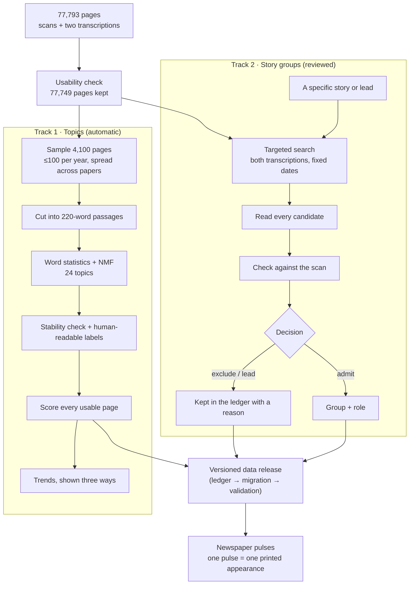

# How the newspaper data becomes topics, groups and pulses

*Process introduction · Project 02 · 7 November 2026*

This project works with 77,793 newspaper pages printed between 1770 and 1810: 110 newspaper series from the Library of Congress's Chronicling America collection, published on Hugging Face as part of the Smithsonian's Revolution Crossroads project. The pages arrive as scans with two machine transcriptions. One is the original Chronicling America OCR ("CA"). The other is a newer AI transcription ("RevX").

Two separate processes turn those pages into the things you see in the project:

- **Topics** are broad themes, such as *shipping and naval encounters* or *land sales*. A computer finds them automatically by grouping words that tend to appear together. They are good for long trends, but a topic is not an event.
- **Groups** are specific stories, such as *Captain Dunbar's report of being plundered by a French privateer*. They are found by searching for the story, reading every candidate, and checking each one against the original scan. The newspaper pulses are built only from these reviewed groups.

The two processes share the same page records, but neither feeds automatically into the other.

---

## Step 0 · Decide which pages are usable

- **Download:** we take a fixed version of the dataset (revision `0b97906…`), so results can be repeated exactly. All six data files are checked against their published checksums.
- **Usability rule:** a page is usable if one of its transcriptions has at least 200 words. RevX is preferred, and CA is the fallback. Exact duplicate pages are removed.
- **Result:** 77,749 of 77,793 pages are usable.

The audit also exposed a basic limit of the archive: coverage is very uneven. 1786 has 356 pages and 1808 has 4,466. In 1785 and 1786 only two newspaper series survive. No series covers all 41 years.

**Why it matters:** if a theme looks bigger in one year, that can simply be because different newspapers survive from that year. Every trend in this project is therefore shown alongside the coverage behind it.

## Track 1 · Topics: finding broad themes automatically

**1. Sample.** Up to 100 usable pages per year are picked, spread evenly across the newspapers available that year. Within each newspaper the pages are chosen by a fixed random rule. The result is 4,100 pages covering all 41 years and all 110 series. Each page carries a weight, so the sample can later be scaled back to the real collection.

**2. Cut into passages.** A newspaper page mixes many unrelated items, so each page is cut into consecutive spans of 220 words. That gives 49,585 passages. These are fixed-length spans, not real article boundaries. About one page in five is held out so we can check later how the topics behave on text the model never saw.

**3. Find the topics.** Each passage becomes a list of word scores (TF-IDF): words that are frequent in that passage but rare overall score highest. A method called non-negative matrix factorization (NMF) then finds 24 recurring word patterns. Each passage gets a weight on each pattern. The settings were:
- Single words and two-word phrases.
- Words appearing in fewer than 12 passages, or in more than 65%, are ignored.
- Common filler words are ignored, including old printing forms such as *fuch* and *faid* (long-s misreadings of "such" and "said").

Nobody told the model what topics to look for.

**4. Check stability and add labels.** The model was fitted a second time from a different random start, and the two runs were compared.
- **Stable topics:** most reappear almost identically (median similarity 0.99).
- **Unstable topics:**
  - T16 *escape and capture-reward notices*: 0.04
  - T20 *Crown, Parliament and royal authority*: 0.20
  - T19 *letter extracts*: 0.50

  These are flagged and not presented as reliable.

Each topic was then labelled by reading its top words and example passages. This was AI-assisted, in Codex. The labels sorted the 24 topics into seven provisional categories, for example *politics and public institutions* and *war, diplomacy and shipping*. Some topics turned out to be formats rather than subjects, such as name lists or letter extracts, and they are marked as such.

**5. Score every page.** The frozen model was applied, without refitting, to all 77,749 usable pages: 1,063,079 passages in total. Re-scoring the whole collection instead of the sample changed the peak year for 12 of the 24 topics. That is a good reminder that the sample-based curves were only a first look.

**6. Show trends three ways.** A topic's share of the text in a year can be calculated against three baselines:

| Baseline | Question it answers |
|---|---|
| Whole collection | How much of the surviving text in this year is about the topic? |
| Each newspaper counted equally | Is the picture driven by one big paper? |
| Only papers present in both years | Does the change survive when the set of newspapers stays the same? |

These baselines can disagree. Between 1774 and 1775, political argument *falls* by 1.5 points in the whole collection but *rises* by 1.4 points among the three papers present in both years. The project shows such disagreements instead of picking one curve.

**What a topic share is not:** it is not how much society cared about something. It is not a count of articles, and it does not say whether a problem was solved. It is a share of the model's word signal in the newspapers that happen to survive.

## Track 2 · Story groups: following specific messages

Topics are too broad to follow one story through the papers. For that, the project uses a slower, reviewed process.

**1. Start from a specific story or lead.** Leads come from two places:
- **Close reading.** Examples: Captain Boyd's report that the French fleet at Bantry Bay "must inevitably be captured", and the seizure of the brig *Peace* at Cayenne.
- **Automatic text-reuse matching.** Code looks across all 1797 pages for passages in different newspapers that share long runs of wording, printed within 120 days of each other. Overlapping matches are grouped into candidate *families*: 629 in 1797, of which 23 reach 4 or 5 papers. The largest families are read first. That is how the report of the British defeat at Tenerife, Duncan's Camperdown dispatches and the Blount letter were found.

**2. Search for it in a fixed window.** Patterns for names and phrases are run over **both** transcriptions of every page in a set date range. For example, the 1797 search looks for "Bantry", "Boyd" near "fleet", and "brig" near "Peace", across all 1,587 usable pages from 1797. Both transcriptions are searched because each one misreads different words. The output is a candidate list, not a result.

**3. Read every candidate.** Most candidates are false hits. In 1797, 28 of 54 were another person named Boyd, or OCR noise such as "a bove" for "above". A candidate counts as the same message only if the actual wording corresponds. Sharing a place name or a date is not enough. When a real match turns up, a second search with its distinctive phrases looks for further printings.

**4. Check against the scan.** Each passage to be admitted is cropped from the original page scan and read. This step regularly changes the picture:
- RevX printed *distressed* where the paper says *dismasted*.
- RevX gave "65, 55" for a longitude printed as "65, 35".
- In one case RevX dropped a printed statement of about 350 words entirely.

Differences between transcription and scan are recorded as transcription errors, not as changes the newspapers made.

**5. Decide and record.** Every candidate gets one recorded decision with a reason:
- **admitted** to a group;
- **excluded**, for example as a false match;
- **lead**, for example a ship with the same name whose identity is unresolved.

Nothing is silently dropped. The decisions live in a ledger file, such as `pipeline/archive_data/ledgers/expansion_1797.json`.

**6. Choose the kind of group.**

| Group kind | Contains | Example |
|---|---|---|
| Message group | Printings of the *same* text | Boyd's fleet report in three papers |
| Context group | Different texts about the same matter | Hand-bill and summary of the Two Sisters wreck |
| Document group | Printings of a document | The 1794 clearance resolution |

A passage can belong to more than one group, and groups can sit inside each other. In the totals, each passage counts once.

**7. Label each appearance's role.** Examples are *report*, *appended challenge*, *later related account*, *condensed report* and *translated document*. A role describes what the printed text does. It is not a verdict on whether the text is true.

### A second reviewed year: 1776 (data releases v0.7.0 to v0.7.2)

The same steps were run for 1776, chosen over 1800 because more of its stories reached many papers and its coverage is steadier.
- **Splitting chains.** Most large automatic families of 1776 joined neighbouring items printed side by side. `pipeline/story_items.py` split them into single printed items and counted where each was printed, on all 2,319 pages of 1776 in both transcriptions. Phrase searches (`pipeline/story_phrase_search.py`) confirmed the printings.
- **Selection.** Every single item printed in 9 or more papers was admitted, except news digests. Items in 7 or 8 papers were chosen to cover January to November and the kinds of news. The result is 22 stories, 31 groups and 246 printings in 16 papers, from the King's speech of October 1775 to the Declaration of Independence and Congress's 88 battalions. Candidates not admitted are recorded, with reasons, in the ledger's `dispositions_summary` (`pipeline/archive_data/ledgers/stories_1776.json`).
- **Scan check.** Every printing was checked against its scan; 23 crops were placed by hand where the page's text layer failed. All 246 printings are on their pages. Of the excerpts, 171 transcriptions are faithful, 44 have minor errors and 31 have errors that change a fact. Every paper printed Congress's resolutions opening the ports with "ſtaves" (staves), and RevX reads "slaves" in eight of the nine.
- **Printed differences** are kept apart from transcription errors. Two papers head those resolutions "March 6" where the others have April 6, and Montgomery's letter to Carleton is dated 6 December in three papers and 16 December in four.
- **Topics.** v0.7.1 adds topic rows for the 31 new groups, from the same frozen model as the matched stories, so the telescope's Topic view can place them.
- **Round two (v0.7.2, 9 November 2026).** The ten candidates in 7 or 8 papers that round one read but did not admit were read again, item by item.
  - **Admitted:** 9 stories (15 groups, 87 printings in 10 papers). Among them are Wilkes's speech in the Commons, Governor Penn before the Lords, the Prohibitory bill, Barry's capture of the *Edward*, the Howe brothers' declarations and Gates on Carleton's retreat.
  - **Not admitted:** the Cork deserters' paragraph is in only 5 papers. Philadelphia committee notices that name people who refused Continental bills are left out. The Cherokee and Creek reports wait for careful framing.
  - **Small sub-stories kept:** three sub-stories in 5 or 6 papers stay, because their stories reach 7.
  - **Scan check:** all 87 printings are on their pages. 54 excerpts are faithful, 15 have minor errors and 18 have errors that change a fact. For example, Wilkes's "ill becomes" is read as "will become" in 3 of 8 printings. The Commons committee report prints the dates of the clause on captures as blanks, and the dates it expects turned out wrong.
  - **1776 now:** 31 stories, 46 groups and 333 printings. The round's findings and each printing's notes are in the data release.

### Connections between stories

Connections were found the same way: search, read, then record. Passages in which two topic groups are both strong, for example shipping and European politics, were read. Fifteen connections that the newspapers state themselves were recorded, such as a decree that cites American newspapers. Each connection is recorded with its type (citation, challenge, claimed cause and so on) and the passage that supports it. Four counterexamples were kept as well, where items merely sat next to each other on a page. A connection a newspaper *asserts* is recorded as an assertion. It does not prove that one thing caused the other. Plainer links are recorded too. For example, a Greenock letter and Boyd's Bantry report were printed side by side in the same three issues, after arriving on the same ship. That is recorded as `printed_alongside` and nothing more.

## Track 3 · Matched stories for every year (automatic, not checked)

Reviewing every story by hand cannot cover 41 years, so coverage comes in two tiers:

| Tier | What it is | Checked against scans? | Where |
|---|---|---|---|
| **Reviewed stories** | Read, grouped by hand, every printing checked on its scan | Yes | Data release tables (observations, groups) |
| **Matched stories** | Found automatically: passages in different newspapers that share long runs of wording | No | Data release derived tables (`reuse_*.parquet`) |

**How matched stories are made:**
1. The text of every usable page is turned into overlapping 5-word fingerprints, the same method used first for 1797.
2. Pages from different newspapers that share many fingerprints, and were printed within 120 days of each other, are compared word by word. A match needs at least 80 corresponding words with 70% similarity.
3. Matches that overlap on the same page are joined into one *matched story*, a family.
4. Each year is processed with a 120-day look-back, so stories that cross a new year are not lost.

**The matcher takes the transcriptions as they are.** It finds what the database's text supports. A matched story can still join two neighbouring items on a page, and printings with badly damaged transcriptions are missed.

**What the first run found (run `run:reuse-all-v1`, data release v0.5.0):**
- 310,155 matches across all 41 years, from 77,749 pages;
- 48,127 matched stories with 179,966 printed appearances;
- 32,870 of these stories are in two newspapers, 8,549 in three and 6,708 in four or more (the largest reaches 15).

**Titles (data release v0.5.1).** The shared wording often starts a few words into a sentence, so each matched story's title is read from the text printed just before it:
- It starts where the item starts, if that is within 30 words. This works for 98% of a 300-story sample and 94% of all 48,127 stories.
- A dateline place is added in front when 2 or more printings agree on it, as in "France · You would be astonished…". That happened for 20% of the sample and 8% of all stories.
- Headings above the item are not used, because they were often section names or the signature of the item before.

**Topics (data release v0.5.2).** The frozen 24-topic model from Track 1 scores the excerpt of every printing, and each story takes its strongest topic. Printings of the same story share their story's topic 89% of the time across all stories with two or more printings, and 76% in a sample of stories with three or more; chance would be about 7%. The telescope's Topic view uses these topics.

**Long-running matches.** Overlapping matches can chain a serial document or a long debate into one family that runs for months, for example Erskine's instructions in 1809–10 (330 pages in 12 newspapers). A family that spans more than 120 days or more than 40 pages is flagged `long_running`. The pulse page lists these separately and leaves them out of the year overview.

**On the pulse page, matched stories appear under "Matched automatically · not checked",** in one neutral colour, with a link to the original page instead of a scan crop. A **Year** menu switches between 1770 and 1810. Each year shows the matched stories that *start* in that year, so a story begun in December can run into January.

**Checks of the matched stories (data release v0.6.0, 8 November 2026).** Matched stories are not read one by one, so they were checked in two ways, and the results are stored in the release.
- **One printing per page** (run `run:printings-merge-v1`). The matcher had listed some pages more than once for a story: overlapping matches with different partner pages, or separate blocks of one page, such as neighbouring items of a news digest. 3,945 stories listed 11,400 pages more than once. Each page now counts once, so the 179,966 appearances became **163,926 printings**. Newspaper counts did not change.
- **Every printing, by machine** (`pipeline/transcription_check.py`, run `run:transcription-check-v1`, `derived/transcription_checks.parquet`).
  - Each page has two machine transcriptions, RevX (AI) and CA (Library of Congress OCR). The check asks whether a printing's passage also appears in the page's other transcription. It counts shared 4-word sequences, compared with how well the two transcriptions agree on the rest of the page.
  - 81.0% of printings are confirmed, 5.4% partly, 2.3% missing from the other transcription although it reads the rest of the page, 10.5% unreadable in the other transcription, and 0.8% have no second transcription.
  - 97.7% of stories have at least one confirmed printing. The pulse page states each printing's result in words.
- **200 stories, against the scans** (`pipeline/audit_matched.py`, run `run:matched-audit-v1`, `derived/matched_audit.parquet`; the protocol, verdicts and crop list are kept in the release's sources). The stories were drawn at random (seed 20261108). Eight AI reviewers read every printing side by side and compared one printing per story with its scan crop. Their verdicts were harmonised under one written rule (`PROTOCOL.md` version 2), and a blind second reader re-judged 30.
  - **One item:** 86% (two-paper stories 91%, three or more papers 75%).
  - **On the page:** every one of the 187 located passages.
  - **Misreadings:** about 1 passage in 5, up to 1 in 3, has a misread word that changes a fact or the sense, such as "persecution" for *perfection*, "2,500" for *3,500*, or "failed" for *ſailed*. The machine check does not catch these: confirmed printings were misread about as often as the rest.
  - So the pulse page carries a standing caution: check the scan before quoting a matched passage.
  - The reviewers were AI assistants, not an independent human reading.

**English notes (data release v0.6.1).** The 6 relation reviews and 16 date roles still in Chinese from the first pilots are now in English. The annotations are superseded; the date roles change in place, with the old values kept in the metadata (`apply_corrections.py`, `ledgers/corrections_2026-11-08.json`).

## From reviewed data to a data release

New decisions never overwrite old ones. Each round of review becomes one release:

**ledger** (the decisions) → **migration script** (applies them to the previous release) → **validation** (automated checks of counts, links, scan files and double counting: 66 for the first reviewed release, 190 for v0.6.1, 449 for v0.7.1) → **frozen release** ([`data/`](../data)).

Earlier releases stay unchanged, so any chart can say which version of the evidence it uses. Corrections follow the same path. For example, v0.2.1 fixes one note that undercounted the length of the dropped statement. It adds a corrected annotation that points back to the old one, and the old one stays in the history.

## From groups to pulses

The pulse view is a direct translation of the admitted group records:

- **Each newspaper is a fixed point, placed by its town of publication.** 1797 has 8 newspapers in the collection, and 1776 has 16.
  - The town comes from the catalogue record (`places_json`), and its coordinates from a short table in `pipeline/build_pulse_explorer.py` (32 towns).
  - North is at the top and east to the right. Crowded coastal towns are spread out, and papers are nudged apart so names stay readable, so the layout keeps the order of places but not distances.
  - Papers from the same town sit side by side.
- **Each admitted passage is one pulse,** placed at its newspaper on its publication date. The same story in three papers makes three pulses. If one paper prints it twice, both printings pulse.
- **Colour shows the passage's role** (report, challenge, later account, document). It does not show truth or a historical phase.
- **There are no copying lines between newspapers.** We show where and when a story appeared, not who copied whom. Most printings name no source, so copying routes are unknown.
- **Seeing which pulses belong together:**
  - *Resonance:* when a paper prints a story, the papers that printed the same story in the previous 40 days glow again at the same moment. Nothing travels between them.
  - *Constellations:* hovering over or tapping a star pauses on its story. The story's papers light up with their printing dates and are joined by faint lines; everything else dims. The lines join nearest neighbours on the map, not printings in date order, and appear all at once, so they group the printings without suggesting a route. The caption says so.
  - *Filter:* "Show stories printed in at least N newspapers". The matched overview defaults to 3, which removes the two-paper matches (68% of all matched stories).
- **Choosing what to follow (9 November 2026).** Nothing is hidden in menus; the page offers what there is.
  - *Years:* a strip of 41 slots, 1770–1810, drawn like the telescope's timeline. Each slot has a bar for how many newspapers survive that year, and a gold dot marks each reviewed year, 1776 and 1797. The chosen years sit in the same pale blue bracket as the telescope's look-back. Tap a year, drag across several, or choose All. A view of many years opens on all its matched stories (a reviewed year on its own opens on its reviewed stories) and puts every newspaper of those years on the map, with smaller markers.
  - *Story shelf:* the stories of the chosen years as cards above the map: the overviews (one for each reviewed year in view, and one for the matched stories), the reviewed stories under their year, then the matched stories (most widely printed first, or earliest first), and the long-running ones. Each card gives the reach, the dates and a row of dots for when it was printed.
  - *Topics and words:* topic chips hold the seven families of the project's topic model. A family chip chooses the whole family and opens its topics, all 24 in all, as a second row to choose one by one; a family with only some topics chosen shows a half light. A find box narrows the stories by the words of their titles. Topics and words narrow the shelf and the map's overview together, so choosing "War" plays every war story of the chosen years.
  - *Speed:* one week to one year of printing per second, as a sliding glass control.
  - *Tour:* the page plays on its own, the current view and then the next card on the shelf. Any click, tap or key holds it for 20 seconds; an open passage or scan holds it while it is read.
  - *Data:* one slim index of all years (`years/index.json`, 8.8 MB, 2.3 MB compressed) holds the newspapers, stories, printings and surviving pages; a passage loads from its year file when it is opened. The reviewed stories of 1776 and 1797 show at once, before the index arrives.
- **The archive coverage display shows which dates have pages at all.** A dark newspaper can mean the paper printed nothing on the story, or that its issues for those dates did not survive.
  - Under each newspaper: whether the archive has a page from it on the current date.
  - A coverage strip above the date slider: for each week (each day in short views), how many of the newspapers on the map have surviving pages. A low or missing bar is a gap in the archive, not silence.
  - Weeks are used because most papers were weekly. Counted by single days, most days would look empty.
- **Each reviewed year has its own overview, "All reviewed stories of 1776" or "… of 1797", which plays all its top-level stories together.**
  - **Categories and colours:** each year names its own three categories, one colour each. Three colours is the most that stay distinguishable, including for colour-blind viewers, when any two are on screen together. So the colour shows the category, and the story's name appears under the newspaper.
    - 1776 (31 stories): *war and the armies* (11), *Britain and Europe* (9) and *independence and American government* (11).
    - 1797 (21 stories): *war, revolution and foreign news* (8), *ships, privateers and wrecks* (5) and *American public life* (8).
    - The years share the three colours: blue is war in both, and green is American public life and government. An overview plays one year, so two years' categories never share the map.
  - **Fading:** a newspaper keeps the colour for 40 days after a printing, then fades.
  - **No double pulses:** each passage belongs to exactly one top-level story.
  - **A sample, not a census:** the overview shows only reviewed stories, a small part of what the papers printed, not every story of the year.

## The story telescope

**Version 2 (7 November 2026)** treats time like looking into the night sky: **the further away, the earlier.**
- **Time and depth:** the front frame is "now"; earlier stories sit further back. "Look back" sets how many years deep you see. The timeline bar, the Earlier/Later buttons and the arrow keys travel through time.
- **Drift:** lets time pass slowly. New stories arrive at the front and older ones recede into the distance.
- **Three views of the same tunnel of time**, with the stars gliding between them:
  - **Place:** the town where each story was first printed in this archive, on a face-on map.
  - **Topic:** a ring of the project's 24 topics, named by hand and grouped into the seven families of the first study, with a gap between families. A star sits on its topic's middle line when the story is about that topic alone, and leans toward its next topic when it mixes topics. Stories in more papers sit toward the rim. Printings of the same story agree on the topic 89% of the time.
    - The families are not used for colour. A spot check of matched stories in three or more papers found that only 2 or 3 of 14 "notices" were notices and 4 of 14 "other" were poems or essays; the rest were news. Advertisements were rarely reprinted across papers, and the model goes by vocabulary, so fire and bridge reports land among the property notices.
  - **Orbit:** a ring of the calendar. Because time also runs into the distance, each year becomes one turn of a spiral, so stories that return at the same season line up as streaks. A check found strong yearly rhythms for Independence Day, Thanksgiving, the President's annual speech, ice, fever and Congress, and none for fires; see [the seasons check](seasons-check.md).
- **Angle:** Front looks straight back through time; Side shows the time axis from an angle.
- **Moving around:** drag to turn the view, right-drag (or two fingers) to move it, and scroll or pinch to zoom. "Reset view" brings back the whole picture.
- **Timeline bar:** under the view, a full 1770–1810 bar shows how many stories each month has, and which stretch of time you are looking through.
- **Search:** typing a word lights up every story that mentions it in its title or opening words, in gold. The other stories turn fainter but keep their size, because a star's size always means how many newspapers printed it. The caption says how many match, in which years, and whether they keep to a season.
- **Compare (8 November 2026):** "vs" between up to three searches gives each its own colour (amber, blue, magenta; a white star mentions more than one). The timeline shows each year's share side by side, Orbit draws each search's months as a line, and ready-made comparisons sit among the suggestions. A colour means only that the words occur, so no classifier can be wrong about it.
  - We chose this after two other ideas failed their checks. Colouring by kind of item (from the topic model) mislabelled most notices. Colouring by where the news came from, read from datelines, works for only about 1 story in 10. Where it does work, European news was a median 65 days old when first printed here, Caribbean news 32 days and American news 6.
  - France · Britain · Congress shows the clearest history: Britain leads the 1770s, France reaches 45–46% of stories in three or more papers in 1793, 1796 and 1798, Congress peaks in 1789 (29%), and Britain returns in 1807–09.
- **Controls:** each single-choice setting is a sliding glass control: tap an option, drag the thumb, or use the arrow keys. On/off buttons (Drift, the kinds of story and the Try suggestions) are separate glass capsules with a small light, lit when on. The suggestion of the current search is lit, and tapping it again clears the search. Every setting can also come from the address, for example `telescope.html?view=topic&lookback=5&angle=side&colour=off&min=4&year=1797&drift=off`, so a view can be linked or scripted.
- **Colour: one control, Region · Search · Off (Region by default),** so a colour on screen only ever means one thing. A search switches it to Search (gold, or a colour per compared search). Choosing Region or Off keeps those colours, and the matches then show as the bright stars, all searches together; the caption says so.
  - Stars keep the same size in every colour mode. Coloured stars are drawn with a steeper glow than plain ones, measured on screen within about 6% of a plain star's width. Before this, region stars were drawn up to 1.3 times as wide, single-search matches 1.5 times and compared matches 1.8 times.
- **Region colours:** each star takes the region of the town where its story was first printed in this archive.
  - Violet is New England, aqua the Middle States, and orange the South and West (Washington, Virginia, Kentucky and South Carolina).
  - Three hues is the most a scatter can carry and stay distinguishable for colour-blind readers; the three were checked on the telescope's background.
  - The colours show the shape of the archive: in the 1780s and 1790s most stories were first printed in the Middle States, and after 1800 most in the South and West.
  - Region colours are drawn one over another, not added, so overlapping regions never mix into a false colour.

Version 1 (below) is kept as `telescope-v1.html`.

`telescope.html` shows every story at once as a field of stars: 48,127 matched stories plus the 21 reviewed ones.

- **Left to right:** the date of first printing.
- **Up and down:** the average latitude of the towns whose papers printed the story, north at the top. A small fixed scatter, up to 0.12°, keeps stories printed by the same papers from stacking into a line.
- **Size and brightness:** the number of newspapers.
- **Colours:** reviewed stories keep their category colours, and matched stories are grey-blue and labelled "not checked".
- **Moving around:** zoom and pan through time. The latitude axis fits the stars in view.
- **Opening a story:** click a star (or tap it twice on a phone) to open it in the pulse view with its printings and passages.
- **Accessible list:** a "Brightest stories in view" list gives the same stories as plain links.
- **Reading it with care:** the field follows the surviving archive. Where few papers survive (for example the South, or 1785–86), there are few stars. That is a gap in the collection, not proof that nothing was printed.

## The website

The views are joined into one site with six pages and a shared header, plus an exhibition page:
- **Home** (`index.html`): a short introduction, a slow time tunnel of stars, and three ways in.
- **Telescope** (`telescope.html`): every story as a star.
- **Pulses** (`pulses.html`): one story or one year, paper by paper.
- **Radio** (`radio.html`): the newspapers read aloud, day by day (below).
- **How it works** (`method.html`): the method in plain language.
- **Research notes** (`notes.html`): the earlier studies.
- **Exhibition** (`exhibit.html`, linked from the footer): a self-running loop for a large screen (below).

The header and footer come from one file, `pipeline/site_parts.py`, so they cannot drift apart. The header's search box searches every story in the telescope. The pages link to each other where it helps: a story on the pulse page has "See it in the sky", and a star in the telescope opens its pulses. The public repository is made from this project by `pipeline/export_public_repo.py`.

**Accessibility (9 November 2026).** An audit of every page checked names, labels, contrast, targets, landmarks and reflow. Fixes:
- a *Skip to content* link that lands right after the menu;
- a main landmark on How it works and the exhibition;
- sliders and legend entries at least 24 pixels tall;
- one Tab stop per single-choice control (arrow keys within it);
- footers and long code that wrap on a 320-pixel screen.

How it works has a section on using the site by keyboard and screen reader.

**The radio (9 November 2026)** reads the newspapers aloud, as if a set could be tuned to the past. Nothing runs on a server and nothing is generated: the browser's own voice (the Web Speech API) reads what was printed, and the sounds are synthesised in the browser (the Web Audio API). The shared code is `pipeline/radio.js`.
- **The radio page:** a year dial over bars of the newspapers that survive each year. It starts on today's date in the year on the dial and greets the town of the first paper: *"Good morning, Philadelphia! It is Saturday, the sixth of July, seventeen seventy-six. From the Pennsylvania Evening Post."* Then it reads one passage from each paper that printed that day, reviewed passages first, then matched passages whose transcription the cross-check confirmed, then the most widely printed. Days with no surviving page are skipped.
- **The switch** sits at the top right of the header, the same on every page that reads aloud (Telescope, Pulses, Radio), and stays on as you move between them in one tab.
- **Pulses and the telescope are not a sequence: many papers speak at once.** One clear voice (the browser's) reads the most notable printing. In an overview that is one printing per story, the reviewed and the confirmed transcriptions first. In one story it is the first printing, then a line on how far the story went in this archive. At the same moment, a chorus reads the opening words of the other papers that print with it. In the telescope, the chorus reads the other stories that reach the front together.
  - The chorus voices come from eSpeak (meSpeak, GPL), made in the browser in a worker (`pipeline/radio-voices.js`), because a browser's own voice can say only one thing at a time.
  - Each paper (or, in the telescope, each town) keeps one voice. It is placed left or right by where it was printed and filtered like a distant set, so the main voice stays clear.
  - Pulses' speed control sets how many speak at once (2 at a week a second, then 3, 3, 4, 5 and 6 at a year a second) and how fast: the clear voice from 1× to 1.65×, the chorus from 175 to 310 words a minute. In the telescope, the look-back sets both, since a longer look-back drifts faster.
  - What pulses while the voices are busy is skipped, not queued, so the sound stays with the picture. Tour waits for the clear voice.
- **Sounds, for atmosphere only:** the hiss of the set, church bells for a new day, a ship's bell in harbour towns, horses on busy streets, birds in the country, a drum under war news. New York has a police siren, a deliberate anachronism the user asked for.
- **Text for speech:** cut marks are dropped, words broken at line ends are joined, and words in capitals are read as words.
- **Limits:** voices differ between browsers (Edge offers natural ones). The words read aloud are the machine transcription, misreadings included. Reviewed passages record their misreadings in notes, but their text is not corrected, so the 1776 ports resolution is heard with "slaves" for the printed "staves".

**Exhibition mode (9 November 2026)**, phase 2 of `docs/site-plan.md`. `exhibit.html` plays seven scenes in a loop:
1. the sky of all the stories;
2. *Peace and Plenty* travelling, with the radio;
3. the Declaration of Independence, with the radio;
4. Independence Day vs fever in Orbit;
5. the topics from the side;
6. the gaps of 1785–89;
7. the radio in July 1776.

How it works:
- **Scenes:** each scene is a page in its exhibition mode (`?exhibit=1`: no menus or lists, large type). It shows a caption that fades after a while, and a QR code for the same view on a phone.
- **Touch:** a touch pauses the loop for exploring, and a minute without a touch brings it back.
- **Staff keys:** F full screen, Space pause, arrows for the scene, M for sound.
- **Burn-in:** the caption changes sides and moves a little every scene.
- **Daily reload:** the page reloads itself at 4 a.m.
- **Sound:** browsers play sound only after a first touch. On an unattended screen, start Chrome with `--autoplay-policy=no-user-gesture-required`.
- **Not built yet:** the offline bundle, with three.js stored locally.

## Worked example · *Peace and Plenty*, October 1797

1. **The lead.** The 1797 search for the seized brig *Peace* used the pattern "brig" near "Peace". It also matched "brig *Peace and Plenty*" in three papers. That is a different ship, so it was not added to the *Peace* group.
2. **Reading.** All three passages carry the same Boston marine report: Captain Dunbar, arriving from St. Croix, says a French privateer from Guadeloupe boarded his brig and took money, letters, stores and rigging.
3. **Second search.** Searching for Dunbar's distinctive phrases ("curse on my country", "inhumanly flogged") across all 1797 pages found a fourth item: a condensed retelling headed *Fraternity* in the *Gazette of the United States* on 16 October.
4. **Scan check.** On 13 October the *Gazette of the United States* scan prints Dunbar's full statement, but RevX leaves it out. The *New Hampshire Gazette*'s "65, 55" is a transcription error; the scan reads "65, 35". Both findings are recorded.
5. **Groups.** The three full versions form a **message group**. That group sits inside a **context group**, which also holds the condensed retelling.
6. **Pulses.** There are four pulses across three newspapers in ten days:

| Date | Newspaper | Role |
|---|---|---|
| 13 Oct 1797 | Gazette of the United States (Philadelphia) | report |
| 16 Oct 1797 | Gazette of the United States | condensed report |
| 17 Oct 1797 | New Hampshire Gazette (Portsmouth) | report |
| 23 Oct 1797 | The Eagle (Hanover, N.H.) | report |

**What the example shows:** when and where this account was printed, and how its wording varied.

**What it does not show:**
- whether Dunbar's account is accurate;
- which paper copied which;
- whether newspapers outside the collection printed it.

## What counts mean

| Unit | Meaning | Not the same as |
|---|---|---|
| Page | One scanned newspaper page | An article |
| Passage (topics) | A fixed 220-word span | An article or a story |
| Selection (groups) | A reviewed excerpt about one story | An event |
| Group | Reviewed selections about one message or matter | A verified historical event |
| Pulse | One admitted selection on its publication date | How many people read it |

## Limits to keep in view

- **Not exhaustive:** the searches find candidates, and they cannot guarantee every printing. Badly damaged transcriptions can hide a match.
- **Not independent:** all reading and scan checks so far were done by AI assistants (Codex, then Claude Code). A second human reader is still needed.
- **Fragile topics:** topic labels and the number 24 are provisional, and three topics are unstable.
- **Not public opinion:** newspaper coverage in a surviving archive is not the same as public opinion, and changes in coverage are not proof of cause or of resolution.

## Where to find things

| What | Where |
|---|---|
| Topic model and sampling | `pipeline/audit_dataset.py`, `pipeline/discover_topics.py` |
| Full-collection scoring and trend checks | `pipeline/recheck_full_corpus.py` |
| Story searches | `pipeline/search_chains.py`, `pipeline/search_pilot_1797.py`, `pipeline/story_phrase_search_1797.py` |
| Text-reuse families, 1797 | `pipeline/reuse_1797.py` (matching), `pipeline/reuse_families_1797.py` (grouping) |
| Reviewed stories, 1776 | `pipeline/year_search_pages.py` (the year's pages), `pipeline/story_items.py` (single printed items), `pipeline/story_phrase_search.py`; the ledger is written by `pipeline/archive_data/ledgers/make_stories_1776.py`, and `pipeline/archive_data/add_reviewed_topics.py` adds the new groups' topics |
| Matched stories, all years | `pipeline/reuse_all.py`, `pipeline/reuse_families_all.py`, `pipeline/reuse_titles_all.py`, `pipeline/story_topics_all.py`; added to the release by `pipeline/archive_data/add_reuse_layer.py`, `add_reuse_titles.py` and `add_story_topics.py` |
| Seasons check | `pipeline/check_cycles_topics.py`, with results in [seasons-check.md](seasons-check.md) |
| Checks of the matched stories | `pipeline/transcription_check.py` (every printing against the page's other transcription), `pipeline/audit_matched.py` (the 200-story audit); added to the release, one printing per page, by `pipeline/archive_data/add_checks_layer.py` with `merge_printings.py` |
| Review decisions and corrections | `pipeline/archive_data/ledgers/`, applied by `pipeline/archive_data/apply_ledger.py`; scan crops made by `pipeline/scan_ledger.py` |
| Data release | [`data/`](../data) (v0.7.2) |
| Website | [`site/`](../site), built by `pipeline/build_pulse_explorer.py` from the templates beside it |
