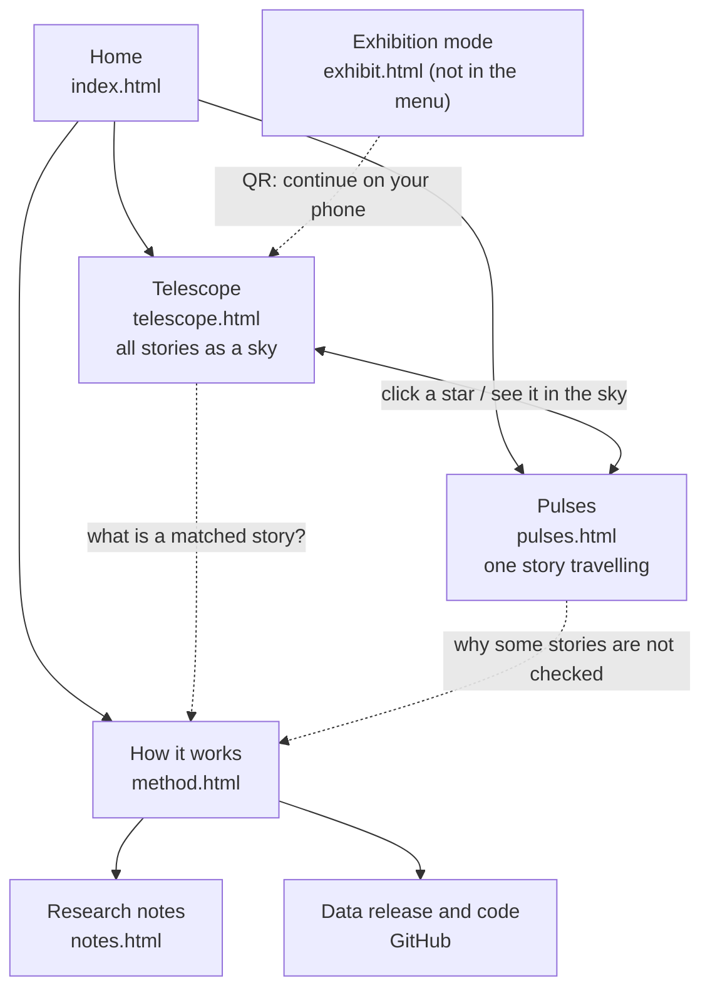

# Site plan: from two tools to one site

*7 November 2026. Phase 1, the site frame, is built. Phases 2 and 3 are still plans.*

The project has grown two strong tools that link to each other: the **story telescope** (all stories, 1770–1810) and the **pulse page** (one story travelling through newspapers). Around them sit a technical method document, a data release and several earlier studies. This plan turns them into one site with a clear way in, shared navigation and a way back out. It also adds an exhibition mode for large screens, which is lower priority.

## Who it is for

| Visitor | What they want | What the site should give them |
|---|---|---|
| **Curious visitor** (web, course audience) | Wonder first, then one story they can follow | A striking first view, one obvious next step, plain language |
| **Researcher** | Find stories, check the evidence, reuse the data | Search, passages, scans, method, data release, stable links |
| **Museum visitor** (wall screen, kiosk) | A few minutes of looking, no instructions | A self-running tour with large captions, optional touch, a QR code to continue on a phone |

## Sitemap



| Page | File | Role | Status |
|---|---|---|---|
| **Home** | `index.html` | The way in: one sentence about the project, a living sky, three doors, search | Built |
| **Telescope** | `telescope.html` | Explore all 48,148 stories; search; Place / Topic / Orbit | Built (v2) |
| **Pulses** | `pulses.html` | Follow one story through the papers; passages and scans | Built; moved here from `index.html` |
| **How it works** | `method.html` | The method in plain language, with limits; links to the full process introduction and data | Built |
| **Research notes** | `notes.html` | Earlier studies: the topic report and the 1797 reading notebook | Built |
| **Exhibition mode** | `exhibit.html` | Self-running tour for large screens | Phase 2 |
| Telescope v1 | `telescope-v1.html` | Kept as a version | Kept |

- **Old links keep working.** A visit to `index.html?year=…&focus=…` (the old pulse links) is forwarded to `pulses.html` with the same parameters.
- **Two earlier studies are in Chinese** (`relations_1793_1800.html`, `research_observatory.html`). They stay in the working project and are not part of the English site.

## Journeys

**1. First visit, curious.**
1. Home shows the sky slowly drifting through time, with one line: *"Every story printed in two or more papers of a surviving archive, 1770–1810."*
2. Three doors: **Look into the sky** (Telescope), **Follow one story** (Pulses, a featured story), **How do we know?** (How it works).
3. In the Telescope, a one-time hint explains stars, depth and clicking.
4. Clicking a star opens its story in Pulses.
5. From Pulses, **See it in the sky** returns to the Telescope with that star lit.

**2. A question in mind.** The visitor types *yellow fever* into the search box in the header, on any page.
1. The Telescope opens with the matches lit, plus the verdict: a strong yearly rhythm, July–September.
2. The caption suggests Orbit, which shows the summer petals.
3. A star opens the story in Pulses.

**3. Researcher.**
1. How it works explains the two tiers (reviewed vs matched) and the limits.
2. Then the data release on GitHub (tables, checks, versions).
3. Every view has a shareable link: `telescope.html?q=…`, `pulses.html?year=…&focus=…`.

**4. Museum visitor.** The wall plays a tour of scenes.
1. A passer-by can touch to explore. After a minute of no touch, the tour resumes.
2. A small QR code opens the same scene on their phone.

**Seamless links between pages**

| From | To | Link |
|---|---|---|
| Telescope star, card or list | Pulses | `pulses.html?year=…&focus=…` (exists) |
| Pulses story | Telescope | **See it in the sky**: `telescope.html?story=ID`, which lights and centres that star (new) |
| Any page, header search | Telescope | `telescope.html?q=…` |
| "Reviewed" and "Matched · not checked" labels, the *How to read* texts | How it works | Anchors such as `method.html#matched`, `#topics`, `#seasons`, `#limits` |
| Year menu in Pulses, year in Telescope | Each other | Same year (exists) |

## Header and navigation

One shared header on every page, above each page's own controls.

```
[✦ Newspaper Night Sky]   Telescope   Pulses   How it works       [ Search 48,000 stories…  ⌕ ]
──────────────────────────────────────────────────────────────────────────────────────────────
(page toolbar: the Telescope's views and filters, or the Pulses playback bar)
```

- **Brand:** a small star mark and the site name, linking home.
- **Menu:** three items, with the current page marked. Research notes and Exhibition mode sit in the footer, not the menu.
- **Search:** in the header on every page; it opens the Telescope with the results lit.
- **Height and stacking:**
  - The header is slim (about 48 px).
  - When the page scrolls, the header scrolls away and the page's own toolbar stays pinned, so controls stay at hand without two bars eating the screen.
- **Phones:** the brand and a menu button; the menu opens a panel with the pages and the search.
  - The Telescope's toolbar is not pinned on phones (as now).
  - The Pulses playback row stays pinned.
- **Footer on every page:**
  - Research notes, data release and code (GitHub), and Exhibition mode once it exists;
  - the data source (Smithsonian Revolution Crossroads / Library of Congress Chronicling America) and the release version;
  - the two-tier note: reviewed vs matched, not checked.
- **Look:** the same dark sky, colour tokens and type as now. Category colours keep their meaning on every page.
- **How it is built:** the page builder (`pipeline/build_pulse_explorer.py`) inserts one header and footer from `pipeline/site_parts.py` into every page, so they cannot drift apart.

**The Pulses page layout (built 7 November):**
- the date slider and coverage strip join the pinned playback bar;
- the heading shrinks to one line;
- the caption sits over the map, so the map shows without scrolling;
- on phones, a short passage card sits right under the map.

## Exhibition mode (phase 2)

A separate page, `exhibit.html`, directs a loop of **scenes**. Each scene is one of the existing pages in an `exhibit` mode:
- no header, toolbars or lists;
- large captions;
- no hover needed;
- the cursor hidden.

| Scene | About | Shown with |
|---|---|---|
| 1. A sky of 48,000 stories | The whole archive, time passing from 1770 to 1810 | Telescope, Place, look back All, Drift |
| 2. One story travels | A message moving from paper to paper | Pulses autoplay: *Peace and Plenty* (reviewed, with scans), then the Declaration of Independence (13 papers) |
| 3. Seasons return | Some news comes back every year | Telescope Orbit, with the Independence Day and fever searches and their petals |
| 4. What the papers talked about | Topics through time | Telescope Topic, Side angle |
| 5. What is missing | Gaps in the surviving archive | Timeline bar, with 1785–90 highlighted |

**Wall and kiosk details:**
- **Sizes:** works at 16:9, ultra-wide and portrait.
  - Type scales with the screen.
  - Lines and stars get an "exhibit scale" so they read on low-density LED walls and on 4K screens.
- **Touch:** touch to explore; return to the tour after 60 s without touch.
- **Staff keys:** F (full screen), Space (pause), ← → (scene).
- **Unattended running:** a slow change of scene and caption position protects screens from burn-in. A daily reload and an error watchdog keep it running.
- **Continue on a phone:** each scene shows a QR code for its web link.
- **Offline:** a version with three.js bundled locally, so the exhibit does not depend on the internet.

## Build order

**Phase 1: the site frame (done, 7 November)**
1. Shared header and footer partial, inserted by the builder into every page.
2. Move Pulses to `pulses.html` and forward old links; the new Home becomes `index.html`.
3. **How it works** page in plain language, with anchors that the other pages link to.
4. **Research notes** index page.
5. **See it in the sky** (`telescope.html?story=…`) and header search on every page.
6. The Pulses layout changes listed above.

**Phase 2: exhibition mode**
1. An `exhibit` mode in the Telescope and Pulses.
2. The `exhibit.html` director with scenes, QR codes, touch and staff keys.
3. Offline bundle.

**Phase 3: polish**
- first-visit hints;
- an accessibility pass;
- hosting: GitHub Pages for the public repository's `site/` folder (the workflow is ready in `.github/workflows/pages.yml`).

## Decisions that shape the build

- **Site name:** *Newspaper Night Sky*, a simpler name chosen on 7 November 2026. The project was called *Newspaper Pulsar* until then.
- **Home page tone:** immersive (the sky fills the page) or editorial (text first, with featured stories). The built Home mixes both: the sky as the top band, featured stories below it.
- **Featured stories** for Home and the exhibit. Suggested:
  - *Peace and Plenty* (reviewed, with scans);
  - the Declaration of Independence (13 papers);
  - Independence Day and fever (yearly rhythms).
