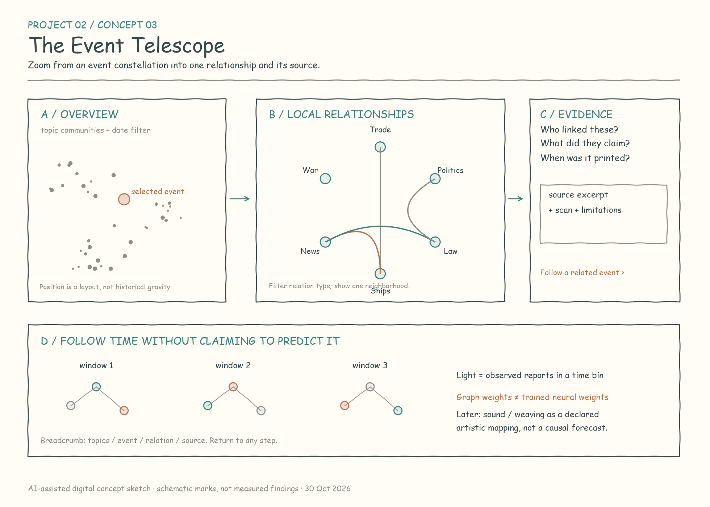
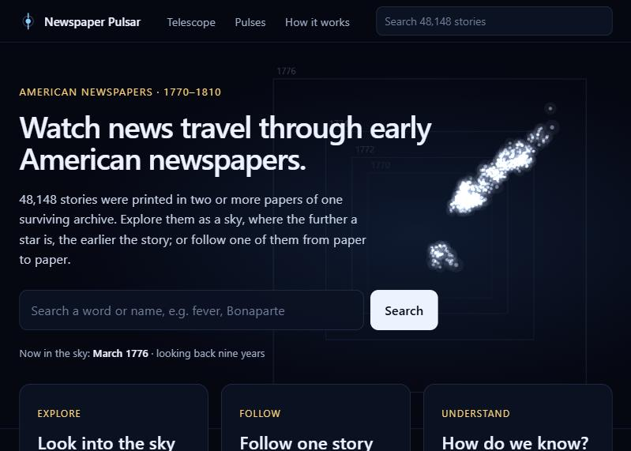

# From proposal to site

## The proposal (1 November 2026)

The proposal offered three concepts, each with a sketch:

1. **The Afterlife of Attention:** topics rising, fading and returning over time.
2. **News in Transit:** one message followed through the newspapers that printed it.
3. **The Event Telescope:** a sky of events that you can focus on.

The recommendation was to develop *News in Transit* as the bounded study and use the *Event Telescope* as its interface.

- [The proposal as submitted](proposals.md), with its [sketches](sketches) (AI-assisted digital drafts) and its [field notes](field-notes.md).
- The files of that stage, including the earlier topic report and the pilot ledgers, are in the course repository, [Major-Studio-1/Project-02-newspapers](https://github.com/Major-Studio-1/Project-02-newspapers/tree/85ba363414d55edd68c96fef4b9ee944b99acef1).

## What changed, and why

1. **Attention became coverage.** The audit showed how uneven the surviving archive is. In 1785 and 1786 only two series survive, against up to 17 a year later. So a topic's share of the text cannot stand for how much society cared about something. The project turned to showing what was printed, side by side with which pages survive.
2. **Transit became pulses.** Following Captain Boyd's report of the French fleet at Bantry Bay through the papers became the pulse view, where each paper flashes when it printed the story. There are no who-copied-whom lines, because papers rarely name their source.
3. **Reviewed stories (1797).** Every candidate was searched, read and checked against the scan, and its decision recorded. Every candidate gets a decision, so nothing is dropped silently. The result is 21 stories with 107 printings, and transcription errors kept apart from real differences between printings.
4. **Matched stories (all years).** The text-reuse method from 1797 was run on all 41 years. It found 48,270 stories printed in two or more papers, kept apart as "not checked".
5. **The telescope.** The event telescope became a sky of all 48,289 stories. Time runs into the depth (the further away, the earlier), with Place, Topic and Orbit views and a search. Orbit grew out of the first question, about problems that keep coming back: it shows which stories return at the same season.
6. **The site.** Home, Telescope, Pulses, How it works and Research notes now share one header. The plan for it is in [`docs/site-plan.md`](../docs/site-plan.md).

## Timeline

| Date | Step | Data release |
|---|---|---|
| 27 Oct | Coverage audit of the whole archive, and the 24-topic pilot | |
| 30 Oct | First message pilot: Boyd, the Cayenne decree, the 1794 resolution | |
| 1 Nov | Proposal submitted | |
| 2–3 Nov | Topic trends rechecked on the whole archive; close reading of 1797; first text-reuse test | |
| 5 Nov | First data release, built from the earlier pilots; search candidates for 1797 | v0.1.0 |
| 6 Nov | 1797 candidates reviewed against the scans; 18 more 1797 stories from text-reuse families | v0.2.0–v0.4.0 |
| 6 Nov | Matched stories for all 41 years; the pulse page shows every year | v0.5.0 |
| 7 Nov | Story titles and topics; the telescope; the site | v0.5.1, v0.5.2 |

The earlier studies are on the site's [Research notes](https://newspapers.icare.love/notes.html) page.
