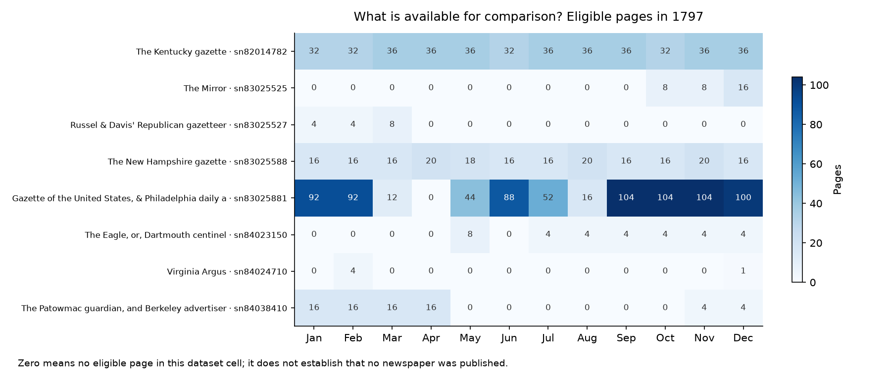
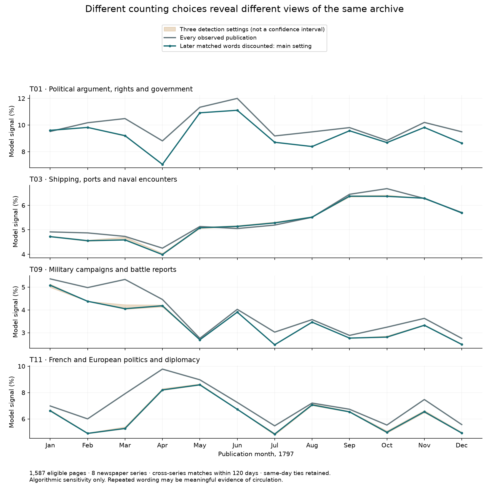
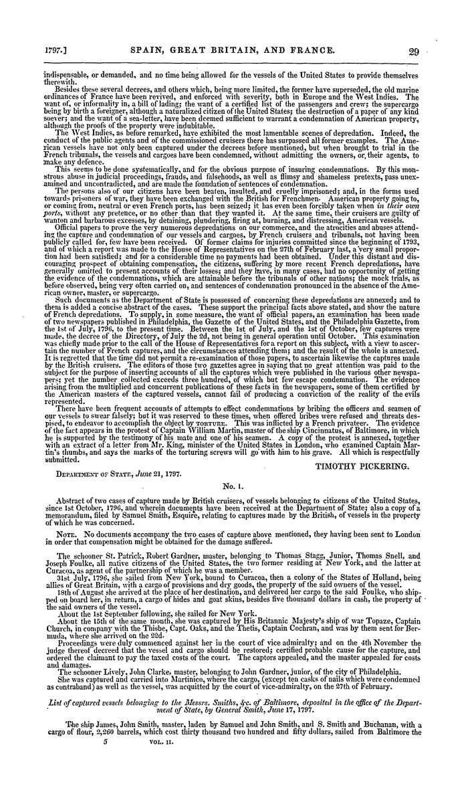
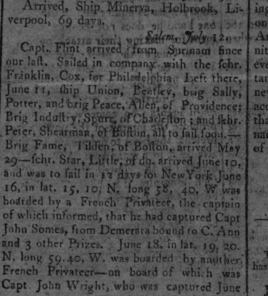
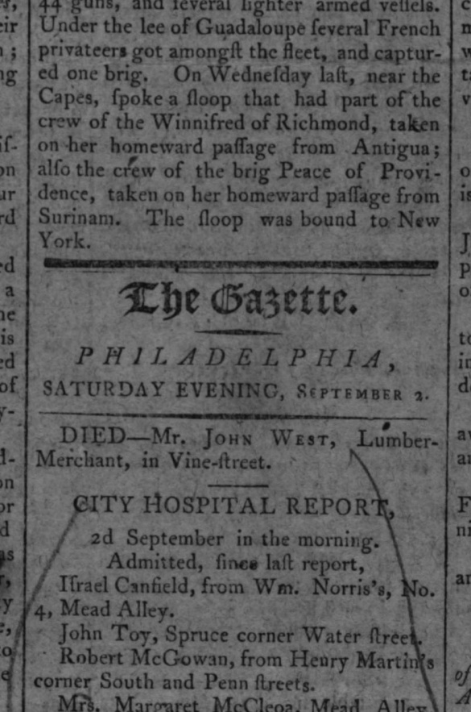
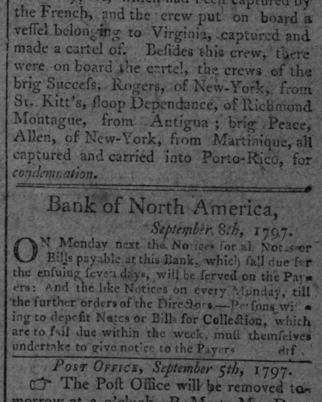
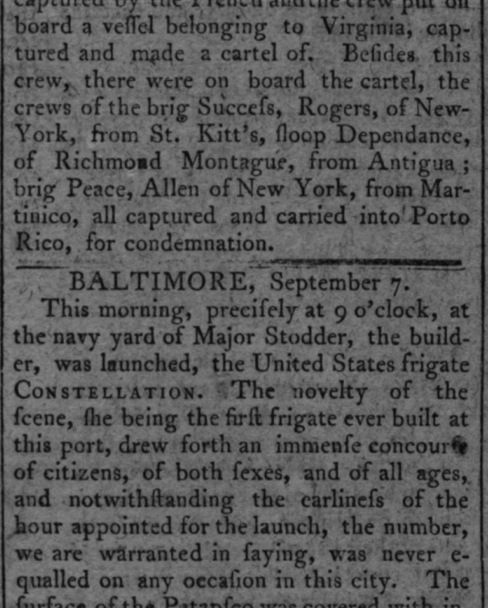

# Reading an incomplete archive: repetition, circulation and visible gaps

3 November 2026. This bounded stage supports open-ended exploration of newspaper evidence. It does not evaluate the whole society or rank historical truth.

## What was completed

The local reuse analysis covers **all 1,587 model-eligible pages from 398 issues/editions and eight newspaper series in 1797**, containing 5,238,385 model word tokens. It compares corresponding passages across different series within 120 days. It is intentionally bounded to one year; no corrected 1770–1810 curve is claimed.

The main setting finds **1,175 candidate passage pairs across 969 page pairs**, touching 621 pages. These are overlapping pairwise matches, not 1,175 distinct stories, articles, copying links or independent events. A separate count of textual families has not been established.

## Counting publications and discounting repeated wording answer different questions

Counting every publication preserves evidence that material appeared repeatedly. Discounting matched words asks how much the model curve depends on repeated wording. Neither is a measure of how many people read, believed or acted on the material.

The main scenario gives zero weight to 328,726 matched word positions in later-dated pages, **6.28%** of the year's observed model words. Overlapping matches are combined before counting. All same-day copies remain; no arbitrary within-day origin is chosen. The broad and strict scenarios discount 6.53% and 5.81%. These are algorithm-conditioned quantities, not population reprint rates or uncertainty bounds.

| Topic | All publications | Later matches discounted | Change |
|---|---:|---:|---:|
| Political argument, rights and government | 9.96% | 9.45% | -0.52 pp |
| Shipping, ports and naval encounters | 5.57% | 5.48% | -0.09 pp |
| Military campaigns and battle reports | 3.75% | 3.40% | -0.34 pp |
| French and European politics and diplomacy | 6.81% | 6.11% | -0.70 pp |

In the main scenario, the shipping topic's highest month moves from October to September, and the French/European politics topic's from April to May. Political argument and military reporting retain June and January peaks respectively. For European politics, March changes from 7.91% to 5.28% (−2.64 percentage points). These comparisons change both topic numerators and the retained-text denominator. They do not isolate a causal effect of reprinting.

## Detection checks and limits

- Broad: at least 60 matching word tokens and 0.60 local similarity; main: 80 and 0.70; strict: 120 and 0.80. All use the same candidate retrieval. These are analyst-chosen settings, not calibrated standards.
- All three previously reviewed Boyd page-pair comparisons are recovered. The short Peace comparison is recovered only by the broad setting: 68 matching tokens lie inside the detected span, although the known core excerpt has 74 word tokens. Endpoint loss and a minimum-length rule can exclude a genuine short shared passage.
- These four known pairs are development checks, not an independent recall test. The broader Boyd match sometimes includes neighboring shared dispatches; a match is not an article boundary.
- Twelve purposefully selected pairs were read as normalized text. They include military letters, congressional debate, proclamations, weather accounts and noisy OCR. This is not a random precision sample; their scans were not newly verified.
- Matching uses word tokens, omitting numeric digits and punctuation. A weather table can retain identical wording even if the figures change. Shared wording does not guarantee identical claims, dates, amounts or meanings. Original scans remain the authority for those details.
- Detection ignores same-series repetition, matches more than 120 days apart, material outside 1797, short matches, and common fingerprints appearing on more than ten pages. It misses heavy OCR corruption and paraphrase. The set of absent matches is not a set of unique stories.
- Later matched tokens inherit the frozen model weights of their 220-word block. This is an approximate allocation, not a new semantic analysis of each matched passage.
- Shared public documents and formulaic announcements can match without one newspaper copying another. No copying route is inferred from dates alone.

## The Peace case: what can actually be connected

The known newspaper versions report a seizure of Peace, Captain Samuel Allen, and attribute the news to Captain Whitney of Maria. They carry an internal Providence dateline of May 13; the observed publication dates are May 18 and May 30, 1797. The event date itself remains unknown. The New Hampshire version adds a Mercury-attributed annotation. Their shared wording is observable; direct copying between the two is not established.

The new contextual finding is in **American State Papers, Foreign Relations, volume 2, printed pp.28–29**. Pickering's report dated June 21 explains that the department examined two Philadelphia newspapers to supplement missing official documents. It acknowledges that the editors had not systematically inserted every capture account and that time did not permit a comparable re-examination for British captures. These are the report's own statements about its evidence, not a modern estimate of its completeness.

The covering message records transmission to the House on June 22 in response to a June 10 request. The annex's Peace entry explicitly cites the Gazette of the United States of May 18 (printed p.62, item19). We can therefore trace a newspaper account into a dated institutional collection. The collection was later printed in the consulted **1832** volume. This neither independently verifies the seizure nor shows that Peace reporting caused the congressional request, a policy change or compensation.

[Official LOC volume](https://tile.loc.gov/storage-services/service/ll/llscd/llsp002/llsp002.pdf) · [Consulted scan, report pp.28–29](https://dheller.org/Timeline-files/US-American-State-Papers/Foreign-Relations-2.pdf#page=32) · [Explicit citation, p.62](https://dheller.org/Timeline-files/US-American-State-Papers/Foreign-Relations-2.pdf#page=66)

There is still no admitted case-matched independent judgment, payment or release record. The Cayenne decree translation remains contextual because its legal relationship to Peace is unproven. A later report's silence is not a measured resolution. The detailed dated records and typed relations are in [the case ledger](peace_case.json).

## Additional search: four later publications, unresolved vessel identity

The 1796–1805 search covered **24,982 page records**, including model-ineligible pages, in both OCR fields. Of 106 candidate pages, two recover the admitted May reports; four later pages were checked against scans; the other 100 were not admitted. This is targeted retrieval, not an exhaustive account of the vessel.

### P031 · 1797-07-17 · Peace, Allen, of Providence, listed at Surinam on June 11
The scan supports the name, master surname, home port and Surinam listing. This is a plausible continuation lead; it neither states a release from Cayenne nor establishes the identity beyond doubt.

### P032 · 1797-09-02 · Crew of Peace of Providence reported after a capture homeward from Surinam
The scan supports the place and route, but does not name the master or connect the capture to the May Cayenne account. Keep as a possible continuation, not a confirmed second capture of the same vessel.

### P033 · 1797-09-08 · Peace, Allen, of New York, reported captured from Martinique
The port and route differ from the May account. Matching name and surname alone do not resolve vessel identity.

### P034 · 1797-09-11 · Corresponding Peace/Allen/New York account appears again
The scan repeats the Porto Rico condemnation account, with Martinico as the departure place. This is another publication, not an independent confirmation or an established continuation of the Cayenne case.

A possible later sighting at Surinam makes the dossier more informative but does not supply the missing release or adjudication record. These leads remain a separate branch rather than a closed event trajectory.

## What this means for an audience-led project

A useful display can let a reader move from a dated publication to corresponding versions, inspect the page, and see what is missing. Keep publication dates, internal datelines, event dates and compilation dates distinct. Label a link as shared wording, explicit citation, document transmission or contextual association. Preserve repeated publication as a view in its own right.

The default view should show coverage and observed publications. A reader may switch the matching threshold or examine a candidate pair without being told that an algorithm has established its truth, significance or causal influence. Exposing the selection and counting choices gives audiences grounds for their own interpretations; it does not make the presentation neutral or exhaustive.

This work can support a later redesigned project without committing to a final visual metaphor. The existing observatory has not been rewritten with these provisional results.

## Reproducibility and files

The data revision and frozen model are the same as in the [previous review](../research_review_2026-11-02/report.en.md). The model was not refit. Fingerprinting uses five-word shingles, rightmost minima in eight-shingle windows, and a six-shared-fingerprint candidate threshold. Fingerprints with more than ten pages or twenty occurrences are omitted. Local seed chains allow gaps up to 100 words and drift up to 60, then token sequence alignment supplies the similarity and exact matched positions. Every matched position is counted at most once per discounted page.

- [Open the reading notebook](reading_notebook.html)
- [Reuse results, settings and positive checks](reuse_results.json)
- [All candidate passage pairs](passage_matches.json)
- [Page coverage and discounted-word counts](page_coverage.json)
- [Twelve-pair inspection notes](match_inspection.json)
- [Peace case record](peace_case.json)
- [Additional case search](peace_search.json)
- [Case-search dispositions](peace_search_review.json)

All interpretation and checking in this stage were performed by the same AI assistant. No independent second-reader reliability or population detection accuracy is claimed.
